# Bitácora de desarrollo — Videojuego "Nexus"

**Asignatura:** Modelado 3D y Videojuegos — Trabajo final
**Motor:** Unity 6 (6000.6.3f1), Universal Render Pipeline (URP)
**Plataformas objetivo:** PC (Windows), Navegador (WebGL) y Android

Cada entrada documenta **qué se hizo**, **cómo se hizo** (pasos, herramientas, comandos o
configuraciones) y **qué problemas aparecieron y cómo se resolvieron**. Las capturas están en
`Evidencias/capturas/`, numeradas en orden cronológico.

Las entradas llevan etiquetas que corresponden a las secciones del artículo de Niixer:
**[Diseño]**, **[Programación]**, **[Arte]** y **[Dificultad superada]**.

## Índice de fases

| Fase | Contenido | Estado |
|---|---|---|
| 0 | Preparación del entorno y del proyecto | Completada |
| 1 | Modelado de objetos (racks, discos, tarjetas, puertas, terminales) | Completada |
| 2 | Personajes Humanoid y selector de personaje | Completada (avatares, animaciones y selector) |
| 3 | Sistemas de juego (movimiento, cámaras fijas, vidas, temporizador, HUD, diálogos, inventario) | Completada (falta controles táctiles) |
| 4 | Inteligencia artificial de los androides | Completada (Nivel 1) |
| 5 | Audio | Pendiente |
| 6 | Construcción de los 3 niveles y menús | En curso (Nivel 1 decorado, menú principal completo) |
| 7 | Exportación a PC, WebGL y Android | Pendiente |

---

## Fase 0 — Preparación del entorno y del proyecto

### 0.1 Análisis del entorno de trabajo — 11/11/2026

**Qué se hizo:** antes de crear el proyecto se revisó qué versión de Unity había instalada y qué
módulos de exportación tenía, porque el juego debe compilarse para tres plataformas y cada una
necesita su propio módulo.

**Cómo se hizo:** se consultaron los editores instalados con la herramienta de línea de comandos
de Unity (`unity editors --installed`) y la lista de módulos de la versión instalada
(`unity install-modules --editor-version 6000.6.3f1 --list`).

**Resultado:**

| Elemento | Estado encontrado |
|---|---|
| Unity Editor | 6000.6.3f1 (Unity 6.6) |
| Windows Build Support | Instalado (incluido con el editor) |
| Web Build Support (WebGL) | Instalado |
| Android Build Support | **No instalado** |
| Espacio libre en disco | 152 GB |

**Decisión:** se mantuvo Unity 6.6 (ya instalado) en lugar de descargar la versión LTS 6.3, y se
eligió la plantilla **Universal 3D (URP)**: la plantilla del Built-in Render Pipeline está en
desuso desde Unity 6.5, y URP es el pipeline recomendado para proyectos que se exportan a móvil
y a navegador.

### 0.2 Instalación del módulo de Android — 11/11/2026

**Qué se hizo:** se instaló el soporte de compilación para Android, que faltaba.

**Cómo se hizo:** se instalaron tres módulos de la versión 6000.6.3f1:

| Módulo | Para qué sirve | Descarga |
|---|---|---|
| Android Build Support | Permite a Unity generar el APK | 1,24 GB |
| Android SDK & NDK Tools | Herramientas de Google para compilar y empaquetar apps Android | 1,12 GB |
| OpenJDK 17 | Java, necesario para el sistema de compilación de Android (Gradle) | 113 MB |

```
unity install-modules --editor-version 6000.6.3f1 --module android --module android-sdk-ndk-tools --module android-open-jdk-17.0.18+8 --yes --accept-eula
```

> Equivale a abrir **Unity Hub → Installs → (versión) → Add modules** y marcar *Android Build
> Support* con sus submódulos *OpenJDK* y *Android SDK & NDK Tools*.

### 0.3 Creación del proyecto — 11/11/2026

**Qué se hizo:** se intentó crear el proyecto `Nexus` con la plantilla Universal 3D (URP).

**Cómo se hizo:**

```
unity projects create "Nexus" --editor-version 6000.6.3f1 --template com.unity.template.urp-blank
```

**Problema encontrado:** el editor se cerró con el **código 198 (fallo de licencia)**. El registro
indicaba `No valid Unity Editor license found. Please activate your license.` La cuenta de Unity
tenía la sesión iniciada, pero el equipo no tenía ninguna licencia activada.

**Causa y solución:** la cuenta ya tenía una licencia **Unity Personal** activada desde el
30/09/2026, como se ve en *Unity Hub → Ajustes → Licencias* (captura 001). El problema era que
**Unity Hub estaba cerrado**: el editor obtiene la licencia y el token de acceso a través del
servicio de licencias del Hub, y al lanzarse sin él no encontró ninguna. Al abrir Unity Hub, la
licencia apareció como activa y el editor pudo abrir el proyecto con normalidad.

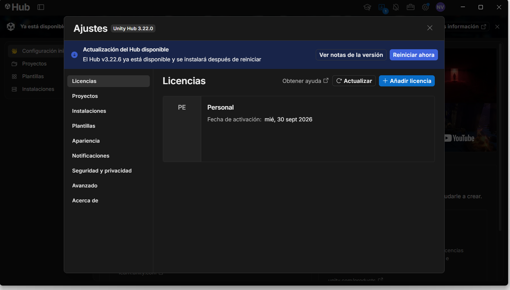

**Estado del proyecto tras el error:** la plantilla sí alcanzó a copiarse completa (`Assets`,
`Packages`, `ProjectSettings`), así que el proyecto se conservó. Solo faltaba el archivo
`ProjectSettings/ProjectVersion.txt`, que el editor escribe al abrir el proyecto por primera vez;
se creó a mano con la línea `m_EditorVersion: 6000.6.3f1` para que Unity Hub reconozca la versión.

**Paquetes incluidos por la plantilla** (`Packages/manifest.json`), relevantes para el juego:

| Paquete | Uso en Nexus |
|---|---|
| Universal RP 17.6.0 | Render pipeline: luces, materiales con emisión, post-procesado |
| Input System 1.19.0 | Controles de teclado, mando y joystick táctil para Android |
| AI Navigation 2.0.12 | NavMesh y NavMeshAgent para la patrulla de los androides |
| uGUI 2.6.0 | Canvas del menú, HUD (corazones, temporizador) y Game Over |
| Timeline 6.6.0 | Disponible para secuencias de introducción |

**Paquete añadido:** `com.unity.pipeline` 1.0.0, que permite controlar el editor desde la línea
de comandos (crear objetos, configurar componentes, entrar en modo Play) durante el desarrollo.

```
unity pipeline install --project-path "...\Videojuego\Nexus"
```

### 0.4 Herramienta de capturas para la bitácora — 11/11/2026

**Qué se hizo:** se creó el script `Evidencias/herramientas/Capturar.ps1` para tomar las
capturas de evidencia de forma uniforme.

**Cómo funciona:**
- Guarda cada imagen en `Evidencias/capturas/` con un número correlativo (`001_`, `002_`…), de
  modo que el orden de las capturas coincide con el orden del desarrollo.
- Puede capturar solo la ventana de Unity aunque esté detrás de otras ventanas. Para eso usa la
  función de Windows `PrintWindow` con la opción `PW_RENDERFULLCONTENT`, que también funciona con
  ventanas que dibujan con la tarjeta gráfica, como el editor de Unity.
- Sin parámetros de ventana, captura la pantalla completa.

```
.\Capturar.ps1 -Nombre "editor-abierto" -Proceso Unity
```

### 0.5 Primera apertura del proyecto — 11/11/2026

**Qué se hizo:** con Unity Hub abierto se abrió el proyecto `Nexus` en Unity 6.6. En la primera
apertura Unity importó la plantilla URP y compiló los paquetes, y el editor quedó listo.

**Cómo se hizo:** `unity open "...\Videojuego\Nexus"`, que equivale a pulsar el proyecto en la
lista de *Proyectos* de Unity Hub.

**Resultado:** el editor abre la plantilla vacía de URP (*URP Empty Template*). El panel
*Project* muestra las carpetas de la plantilla (`Scenes`, `Settings`, `TutorialInfo`) y los
paquetes instalados (*AI Navigation*, *Input System*, *Scriptable Render Pipeline*, etc.).

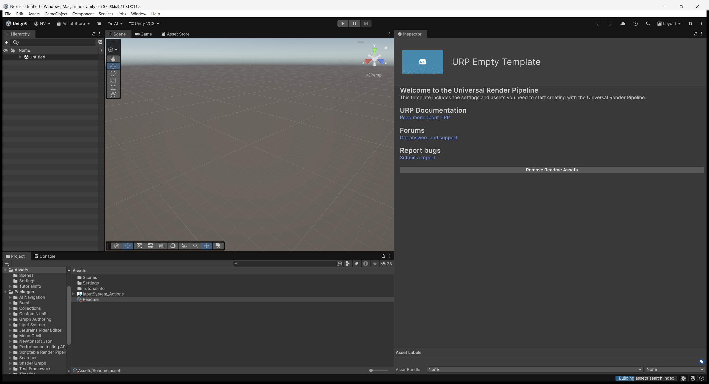

### 0.6 Organización del proyecto y escenas de los niveles — 11/11/2026

**Qué se hizo:**

1. Se eliminaron los archivos de bienvenida de la plantilla (`TutorialInfo` y `Readme.asset`) y
   la escena de ejemplo `SampleScene`, que no forman parte del juego.
2. Se creó la carpeta `Assets/Nexus/` para separar el contenido propio del juego de los ajustes
   de la plantilla. Dentro hay una subcarpeta por tipo de recurso:

   | Carpeta | Contenido previsto |
   |---|---|
   | `Escenas` | Menú y los tres niveles |
   | `Scripts` | Código C# (jugador, androides, cámaras, HUD, temporizador…) |
   | `Prefabs` | Rack de servidores, disco duro, tarjetas, puertas, androides |
   | `Materiales` | Metal de los racks, emisión azul de los discos, luces LED |
   | `Texturas` | Rejillas de ventilación, paneles, suelos |
   | `Modelos` | Personajes y androides importados (FBX de Mixamo) |
   | `Animaciones` | Clips de caminar/correr/idle y Animator Controllers |
   | `Audio` | Zumbido de ventiladores y alarma |
   | `UI` | Iconos de vidas, fuentes y elementos del HUD |
   | `PerfilesBuild` | Perfiles de compilación de cada plataforma |

3. Se crearon las cuatro escenas del juego y se añadieron a la lista de compilación en este
   orden (el número indica el índice de carga):

   | Índice | Escena | Contenido |
   |---|---|---|
   | 0 | `00_Menu` | Menú principal y selector de personaje (Canvas 1) |
   | 1 | `01_Mantenimiento` | Nivel 1: Cuarto de Mantenimiento (tutorial) |
   | 2 | `02_Almacenamiento` | Nivel 2: Pasillos de Almacenamiento (laberinto) |
   | 3 | `03_Nucleo` | Nivel 3: El Núcleo de Datos (clímax) |

**Cómo se hizo:** con un script de editor en C# ejecutado dentro de Unity. Usa
`AssetDatabase.CreateFolder` para las carpetas, `EditorSceneManager.NewScene` y `SaveScene` para
las escenas, y `EditorBuildSettings.scenes` para la lista de compilación. Es lo mismo que hacer
*clic derecho → Create → Folder / Scene* en el panel Project y arrastrar las escenas a
*File → Build Profiles → Scene List*.

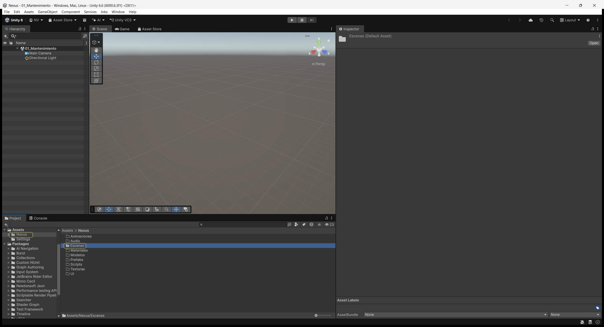

### 0.7 Configuración del reproductor (Player Settings) para las tres plataformas — 11/11/2026

**Qué se hizo:** se configuraron los ajustes del ejecutable final de cada plataforma.

**Cómo se hizo:** *Edit → Project Settings → Player*, aplicado mediante la API `PlayerSettings`
desde un script de editor.

| Ajuste | Valor | Motivo |
|---|---|---|
| Company Name | Nexus Team | Identifica al desarrollador en los builds |
| Product Name | Nexus | Nombre del juego en la ventana, el navegador y el móvil |
| Version | 0.1.0 | Versión inicial |
| **PC** — Modo de pantalla | Pantalla completa en ventana, redimensionable | Comportamiento estándar en Windows |
| **Android** — Package Name | `com.nexusteam.nexus` | Identificador único obligatorio de toda app Android |
| **Android** — Scripting Backend | IL2CPP | Requisito para compilar en 64 bits (ARM64) |
| **Android** — Arquitectura | ARM64 | La de los móviles actuales; reduce el tamaño frente a incluir ARMv7 |
| **Android** — Nivel mínimo de API | 26 (Android 8.0) | Valor por defecto de Unity 6.6 |
| **Android** — Orientación | Solo horizontal (izquierda y derecha) | El juego se diseña para pantalla apaisada |
| **Web** — Compresión | Gzip con *Decompression Fallback* | El build funciona en cualquier servidor web, incluso sin configurar cabeceras de compresión |

**Niveles de calidad:** la plantilla URP trae dos (*Mobile* y *PC*). Se verificó que Android y Web
usan **Mobile** (sombras y efectos más ligeros) y que Windows usa **PC**.

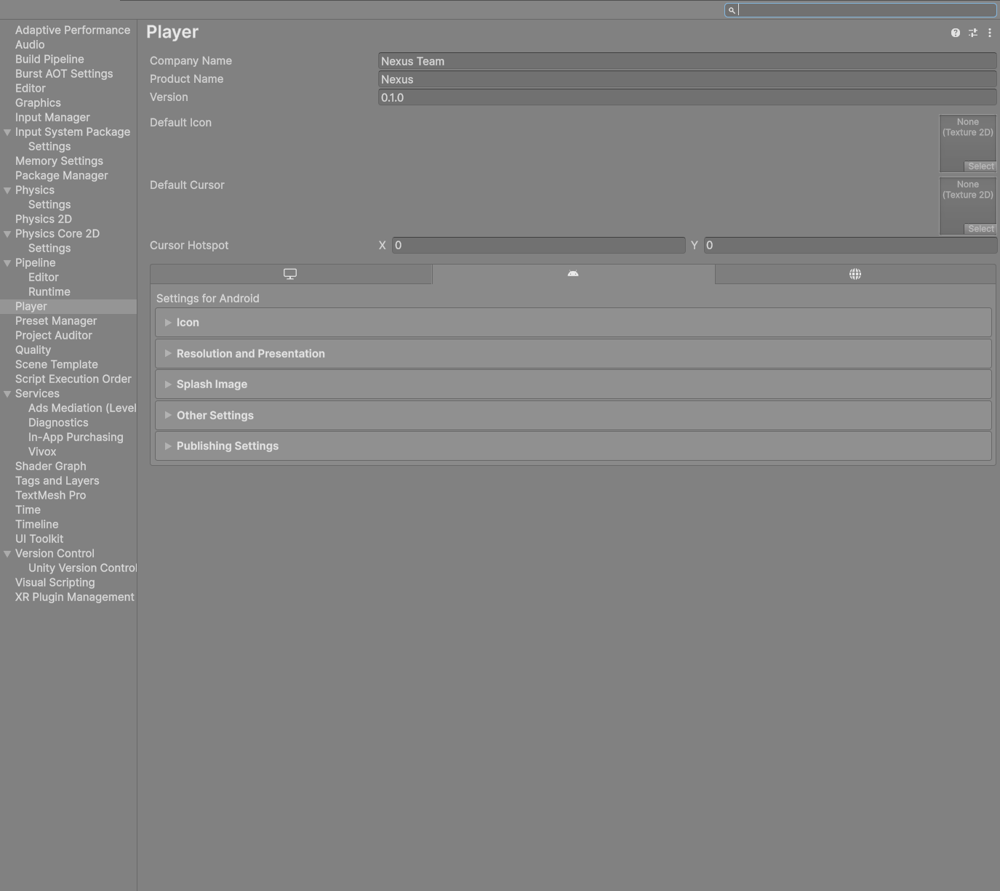

### 0.8 Perfiles de compilación (Build Profiles) — 11/11/2026

**Qué se hizo:** se creó un perfil de compilación por plataforma: `Nexus_PC_Windows`, `Nexus_Web`
y `Nexus_Android`, guardados en `Assets/Nexus/PerfilesBuild`.

**Por qué:** en Unity 6 los *Build Profiles* reemplazan a la antigua ventana *Build Settings*.
Cada perfil guarda la configuración de exportación de su plataforma, y para cambiar de
plataforma basta con seleccionar el perfil y pulsar *Switch Profile*. Así las tres versiones del
juego se generan desde el mismo proyecto.

**Cómo se hizo:** *File → Build Profiles → Add Build Profile* y elegir la plataforma; en este
caso se creó con el comando del editor `build create_profile`.

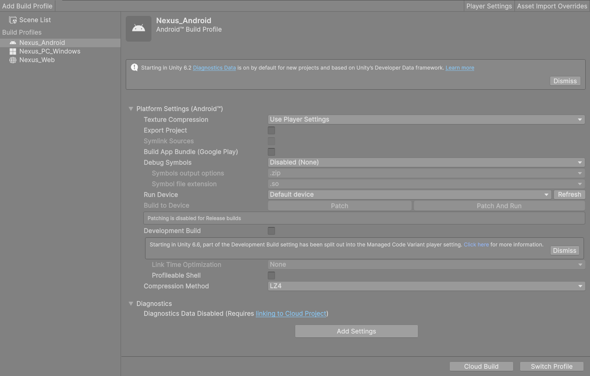

**Verificación final de la fase:** la consola de Unity terminó con 0 errores y 0 advertencias, y
el proyecto quedó guardado.

---

## Fase 2 — Personajes: avatares de los integrantes

Los dos personajes jugables (Modelo A y Modelo B del selector) son **avatares 3D de los dos
integrantes del equipo**, creados con **Avaturn**, una herramienta que genera un avatar a partir
de fotos de la persona.

### 2.1 Revisión de los primeros archivos de avatar — 11/11/2026 · [Dificultad superada]

**Qué se hizo:** antes de importarlos a Unity se inspeccionaron los archivos con Blender en modo
consola (`blender -b --python inspeccionar.py`). El script lista las mallas, la armadura, los
huesos y las texturas de cada modelo.

**Problema encontrado:** los primeros archivos entregados (`Neyder.fbx` y `Personaje_Deisy.fbx`)
no servían tal como estaban:

| Archivo | Esqueleto (rig) | Texturas | Consecuencia |
|---|---|---|---|
| `Neyder.fbx` | Sí, 65 huesos | No incluidas: el FBX las buscaba en una carpeta `textures\packed\` inexistente | El personaje se vería gris en Unity |
| `Personaje_Deisy.fbx` | **No**: mallas sin pesos ni armadura | No incluidas | Modelo estático: no se puede configurar como Humanoid ni animar |

**Solución:** se volvieron a descargar los dos avatares desde Avaturn en formato **GLB** (glTF
binario), que guarda en un solo archivo la malla, el esqueleto y las texturas. Al revisarlos, los
dos GLB tenían una armadura de **52 huesos** con nombres estándar (`Hips`, `Spine`, `LeftArm`,
`LeftUpLeg`…) y todas sus texturas incluidas (de 1024×1024 y 512×512).

| Avatar | Triángulos | Piezas |
|---|---|---|
| Neyder | ~18.800 | Cuerpo, pelo, ropa, zapatos |
| Deisy | ~29.300 | Cuerpo, pelo (2 capas), ropa, zapatos |

### 2.2 Conversión de GLB a FBX con Blender — 11/11/2026 · [Arte]

**Qué se hizo:** se convirtieron los dos GLB a **FBX**, el formato que usa el importador de
modelos de Unity con la configuración de Avatar Humanoid.

**Cómo se hizo:** con un script de Python para Blender (`glb_a_fbx.py`) que:
1. Importa el GLB.
2. Elimina una malla auxiliar (una esfera sin material) que Avaturn incluye en la exportación.
3. Exporta solo la armadura y las mallas, con **las texturas incrustadas dentro del FBX**
   (*Path Mode: Copy* + *Embed Textures*), sin huesos extra de punta (*Add Leaf Bones* desactivado)
   y con escala en metros.

Equivale en Blender a *File → Import → glTF 2.0* y luego *File → Export → FBX* con esas opciones.
Cada FBX resultante pesa unos 4 MB, frente a 1 MB del original, porque ahora lleva las texturas.

### 2.3 Importación y configuración como Avatar Humanoid — 11/11/2026 · [Arte]

**Qué se hizo:** se importaron `Neyder.fbx` y `Deisy.fbx` en `Assets/Nexus/Modelos/Personajes` y
se configuraron con el **sistema de Avatar Humanoid** de Unity, como pide la rúbrica.

**Cómo se hizo:** en el Inspector del modelo (*Import Settings*):

| Pestaña | Ajuste | Valor | Para qué |
|---|---|---|---|
| Model | Bake Axis Conversion | Activado | Corrige la diferencia de ejes entre Blender (Z arriba) y Unity (Y arriba) |
| Model | Import Cameras / Lights | Desactivado | El modelo no los necesita |
| **Rig** | **Animation Type** | **Humanoid** | Unity reconoce el esqueleto como humano y puede reutilizar cualquier animación humanoide |
| **Rig** | **Avatar Definition** | **Create From This Model** | Se crea un Avatar propio a partir del esqueleto de cada integrante |
| Animation | Import Animation | Desactivado | Los avatares no traen animaciones; se usarán las de Mixamo |
| Materials | Material Creation Mode | Import via MaterialDescription | Unity crea materiales URP Lit a partir de los del FBX |

**Verificación:** Unity generó `NeyderAvatar` y `DeisyAvatar`, los dos **válidos y humanos**, con
los **52 huesos mapeados** y ningún hueso obligatorio sin asignar. En la vista
**Configure Avatar** todo el esqueleto aparece en verde (cada punto es un hueso humano asignado
a un hueso del modelo: Hips, Spine, Chest, brazos, piernas, cabeza y dedos).

**¿Por qué Humanoid?** El sistema Humanoid traduce el esqueleto de cada modelo a un esqueleto humano
estándar de Unity. Gracias a eso, **una misma animación** (caminar, correr, recibir daño) funciona
en los dos avatares y en los androides enemigos, aunque cada modelo tenga proporciones distintas.
Esto es lo que permite el selector de personajes con un único Animator Controller.

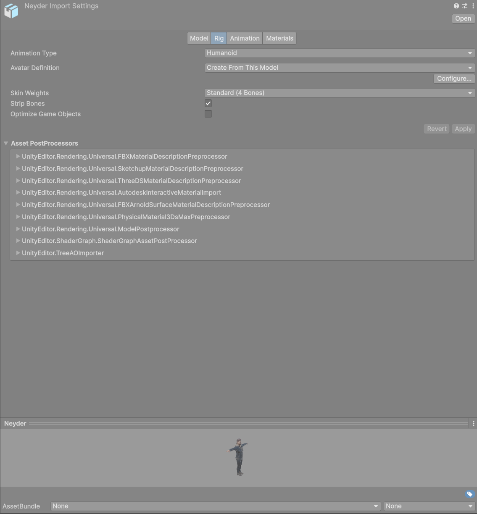

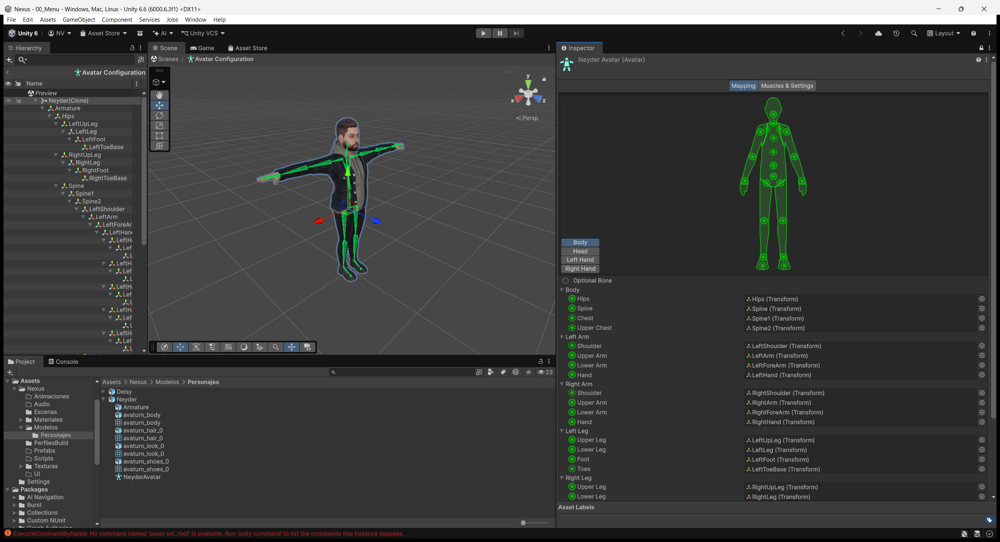

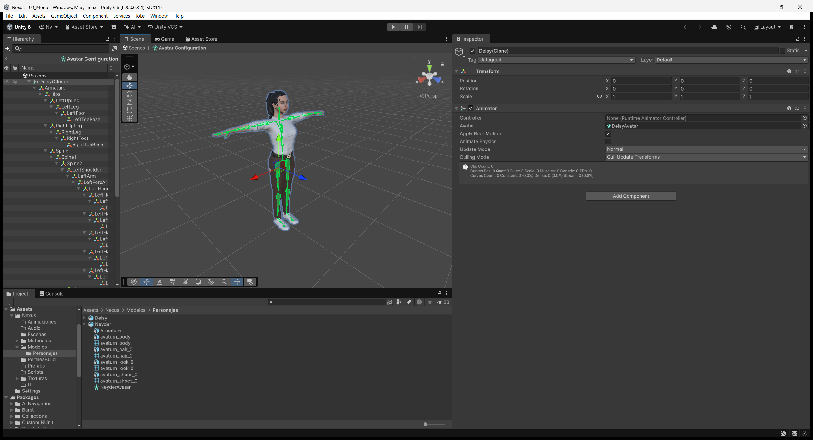

### 2.4 Materiales y texturas en URP — 11/11/2026 · [Arte] · [Dificultad superada]

**Qué se hizo:** se extrajeron las texturas y los materiales del FBX a sus carpetas
(`Texturas/Personajes/<nombre>` y `Materiales/Personajes/<nombre>`) para poder editarlos, y se
ajustaron para URP.

**Problemas encontrados y soluciones:**

1. **Los materiales salieron sin textura.** El importador creó materiales URP Lit, pero vacíos.
   Para saber qué imagen corresponde a cada material, se leyó el árbol de nodos de los materiales
   del GLB en Blender (qué imagen va a *Base Color* y cuál a *Normal*). Después se asignaron en
   Unity: **Base Map** (color) y **Normal Map** (relieve de tela y piel). Las texturas de relieve se
   marcaron como *Texture Type: Normal map*.
2. **El pelo necesita transparencia.** El pelo de Avaturn usa una textura PNG con canal alfa. Se
   configuró con **Alpha Clipping** (umbral 0,4) en lugar de transparencia real, porque en móvil y
   WebGL es más barato y no tiene errores de orden de dibujado. También se activó el renderizado a
   **doble cara** (*Render Face: Both*), para que los mechones se vean desde cualquier ángulo.
3. **Aspecto metálico.** En la primera vista previa los personajes se veían oscuros y brillantes
   como metal. Se ajustó el flujo de trabajo a *Metallic* con *Metallic = 0*, y se colocó la luz
   direccional delante de los personajes (antes estaba detrás y los iluminaba a contraluz).

**Resultado:** los dos avatares se ven con su ropa, piel y pelo, en pose T, que es la pose de
referencia del sistema Humanoid. Ya están colocados en la escena `00_Menu`, donde irá el selector
de personajes.

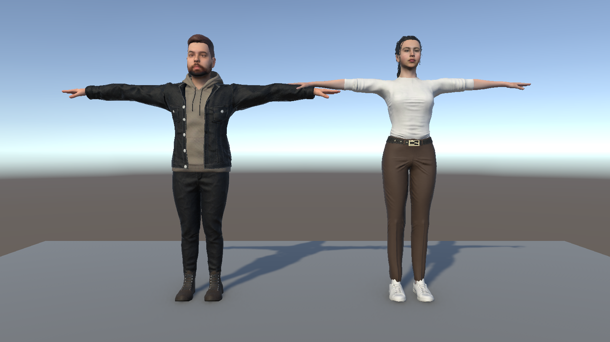

---

## Fase 1 — Modelado de objetos y del entorno

### 1.1 Herramienta de construcción en el editor — 11/11/2026 · [Programación]

**Qué se hizo:** en lugar de armar cada objeto a mano, se programó una herramienta de editor
(`Assets/Nexus/Editor/ConstructorFase1.cs`) que agrega al menú de Unity la opción
**Nexus → Fase 1** con tres pasos: *Generar texturas*, *Crear materiales* y *Construir prefabs*.

**Por qué:** cada ajuste (el brillo de un LED, el tamaño de una tarjeta, el color de un material) se
cambia en un solo lugar y se reconstruyen todos los objetos con un clic. Durante esta fase eso
permitió corregir varias veces la iluminación y los materiales sin rehacer nada a mano.

Todos los objetos se modelan con **primitivas de Unity** (cubos, quads) combinadas, como se definió
en el diseño. Cada objeto queda guardado como **prefab** en `Assets/Nexus/Prefabs/`, listo para
clonarlo en los niveles.

### 1.2 Texturas procedurales — 11/11/2026 · [Arte]

**Qué se hizo:** las texturas se generan por código, píxel a píxel, en lugar de descargarlas. Así
son originales y no tienen problemas de licencia. Junto con cada textura de color se genera un
**mapa de alturas**, y a partir de él un **normal map** que da relieve a la luz (los agujeros se ven
hundidos y las asas sobresalen).

| Textura | Tamaño | Contenido |
|---|---|---|
| `T_Rack_Frente` (+ normal) | 256 × 1024 | Frente de un rack: rieles laterales con agujeros de montaje, 10 servidores ("cuchillas") con malla perforada hexagonal, etiqueta con código de barras, huecos para LEDs, botón y asa; rejilla de ventilación inferior |
| `T_Piso` (+ normal) | 512 × 512 | Suelo técnico de centro de datos: baldosas de 60 cm con tornillos, una de cada cuatro perforada para la ventilación |
| `T_Pared` (+ normal) | 512 × 512 | Paneles metálicos con juntas, remaches, banda horizontal y zócalo |
| `T_Peligro` | 256 × 256 | Franjas diagonales amarillas y negras para los marcos de las puertas |
| `T_Metal_Cepillado` | 256 × 256 | Vetas horizontales de metal cepillado |
| `T_Tarjeta_Roja` / `_Azul` | 256 × 160 | Tarjeta de acceso: banda blanca, chip dorado y logotipo de anillo |

### 1.3 Shader de LEDs parpadeantes — 11/11/2026 · [Programación] · [Arte]

**Qué se hizo:** se escribió un shader propio en HLSL para URP (`Nexus/LED Parpadeo`,
`Assets/Nexus/Shaders/LED_Parpadeo.shader`).

**Cómo funciona:**
- El parpadeo se calcula en la **GPU** a partir del tiempo (`_Time`), sin ningún script. Un nivel
  tiene cientos de LEDs, y con un script por LED el juego se volvería lento en Android y WebGL.
- Cada LED guarda en su **color de vértice** su color (verde, azul, ámbar o rojo) y, en el canal
  alfa, un **desfase**. Así todos los LEDs de un rack forman un único mesh, que se dibuja en una sola
  llamada de dibujo, y aun así cada uno parpadea a su ritmo.
- La posición del rack en el mundo añade otro desfase, para que dos racks iguales no parpadeen
  sincronizados.
- El color se multiplica por una intensidad mayor que 1 (HDR) para que el efecto **Bloom** del
  post-procesado haga brillar los LEDs.
- El mismo shader, con el parpadeo desactivado y un **pulso** suave, se usa en el neón del disco
  duro, en la luz del lector de las puertas y en las pantallas de las terminales.

### 1.4 Rack de servidores — 11/11/2026 · [Arte]

**Composición** (prefab `Rack_Servidor`, 0,6 × 2,0 × 1,0 m):

| Pieza | Primitiva | Material |
|---|---|---|
| Cuerpo | Cubo | `M_Rack_Cuerpo`: metal cepillado oscuro |
| Frente y trasera | 2 quads | `M_Rack_Frente`: textura de rejilla + normal map |
| LEDs | Mesh generado con 80 LEDs (40 por cara) | `M_LED_Rack`: shader de LEDs |
| Colisión | Box Collider | Bloquea al jugador y a los androides |

Las posiciones de los LEDs se calculan a partir de las mismas medidas en píxeles que usa la
textura, así que cada LED cae exactamente sobre su hueco. El rack es la pieza base de la
arquitectura de todos los niveles: los pasillos y el laberinto se construyen clonándolo.

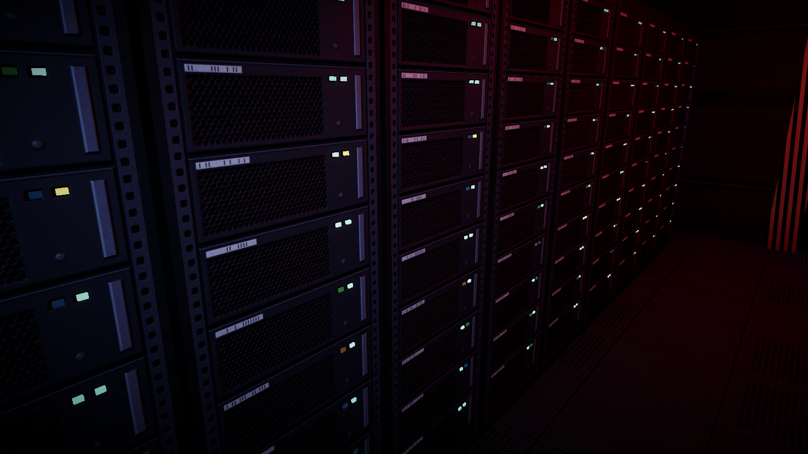

### 1.5 Disco Duro Maestro (coleccionable) — 11/11/2026 · [Arte]

**Composición** (prefab `Disco_Duro_Maestro`): un cubo metálico de 26 cm (`M_Disco_Metal`, muy
metálico y pulido), un **anillo de neón azul** alrededor y dos placas de neón arriba y abajo
(material con emisión HDR y pulso suave), más una **Point Light azul** que ilumina el entorno.
El script `FlotarGirar` lo hace girar y flotar, y `Coleccionable` (con un Sphere Collider en modo
*Trigger*) lo suma al inventario cuando el jugador lo toca.

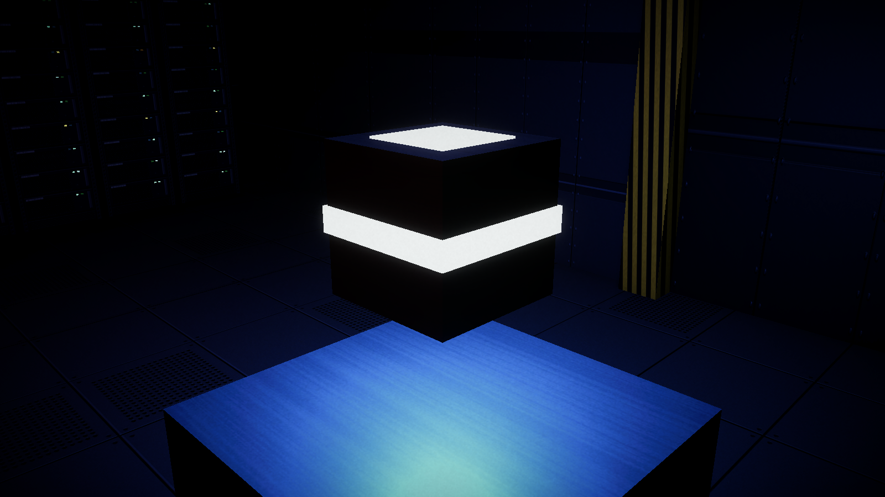

### 1.6 Tarjetas de acceso — 11/11/2026 · [Arte] · [Dificultad superada]

**Composición:** una lámina de 22 × 14 cm con la textura de tarjeta, que gira y flota, más una
pequeña luz de su color. Hay dos prefabs, roja y azul, que abren las puertas de su color.

**Problema:** en la primera prueba la tarjeta roja era invisible dentro de su alcoba. La luz de la
sala era roja y la emisión del material no funcionaba, así que la tarjeta se confundía con la
pared. La causa es que URP vuelve a validar los materiales al importarlos y apaga la emisión
(`_EMISSION`) si el material tiene la iluminación global en *None*.

**Solución:** marcar la emisión como *Realtime Emissive*, aumentar su intensidad y cambiar la luz de
la alcoba a un tono frío para que el rojo contraste. Ahora la tarjeta brilla e incluso tiñe el
suelo de rojo.

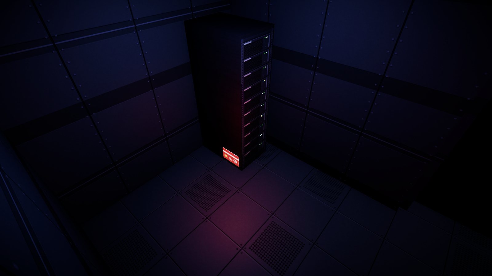

### 1.7 Puerta de seguridad — 11/11/2026 · [Arte] · [Programación]

**Composición:** marco con franjas de peligro (dos columnas y un dintel), dos hojas metálicas que
se deslizan hacia los lados, y un lector de tarjetas con una luz que indica el estado: el color de
la tarjeta necesaria si está cerrada, verde si está abierta. Hay tres variantes: roja, azul y libre.

**Script `PuertaSeguridad`:** un Box Collider en modo *Trigger* detecta al jugador; si lleva la
tarjeta correcta en el inventario, las hojas se abren con una animación suave (`SmoothStep`) y se
desactiva el `NavMeshObstacle` que impedía pasar a los androides. Emite un evento (`AlIntentarAbrir`)
para que el HUD muestre "Acceso concedido" o "Se requiere tarjeta roja".

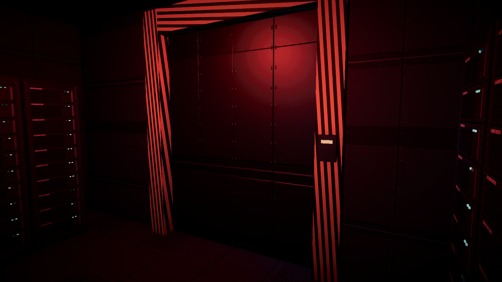

### 1.8 Terminal Nexus — 11/11/2026 · [Arte] · [Dificultad superada]

**Composición:** consola, teclado inclinado, monitor con pantalla emisiva verde y **texto real en
la pantalla**, hecho con TextMeshPro en el espacio 3D (`NEXUS OS v3.2 > ALERTA…`). El script
`TerminalNexus` guarda los mensajes que se mostrarán en los cuadros de diálogo.

**Problema:** TextMeshPro necesita sus recursos básicos (fuente y ajustes), que no venían en el
proyecto. Al importarlos, el editor se quedó "congelado": Unity casi no se actualiza mientras su
ventana está en segundo plano, y la importación esperaba esas actualizaciones.

**Solución:** se activó la opción del editor para que siga actualizándose aunque no tenga el foco, y
se importó el paquete *TMP Essential Resources*.

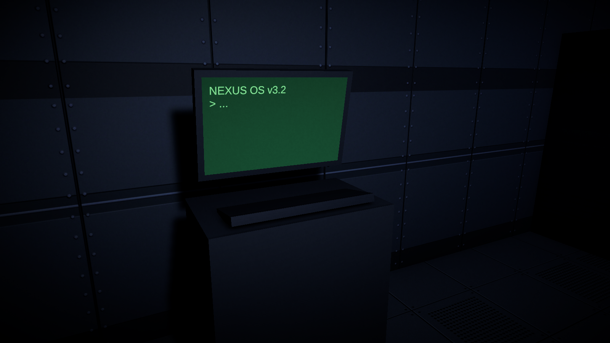

### 1.9 Módulos de construcción — 11/11/2026 · [Arte]

Para construir los niveles se crearon dos módulos de **3 × 3 m**: `Modulo_Piso_3x3` y
`Modulo_Pared_3x3` (3 m de alto). Cada uno tiene su propio material con la repetición de textura
ajustada a su tamaño, para que las baldosas y los paneles midan lo mismo en todo el juego. Los
niveles se arman encajando módulos en una cuadrícula de 3 m.

---

## Fase 3 (adelanto) — Cámaras fijas y movimiento del jugador

### 3.1 Sistema de cámaras fijas — 11/11/2026 · [Programación] · [Diseño]

**Qué se hizo:** dos scripts implementan las cámaras fijas en las esquinas, al estilo del survival
horror clásico:

- **`GestorCamaras`**: agrupa todas las cámaras del nivel y mantiene **solo una encendida**. Además
  de crear tensión (el jugador oye a los androides pero no siempre los ve), renderizar con una sola
  cámara es más barato en móvil y en WebGL.
- **`ZonaCamara`**: un Box Collider invisible en modo *Trigger* que cubre el suelo de una sala o
  pasillo. Cuando el jugador lo pisa, pide al gestor que encienda la cámara de esa zona. En el editor
  se dibuja como una caja celeste con una línea hacia su cámara, para diseñar los niveles a ojo.

### 3.2 Controlador del jugador — 11/11/2026 · [Programación] · [Dificultad superada]

`ControladorJugador` mueve al técnico con un **CharacterController** y el **Input System** (teclado,
mando y, más adelante, joystick táctil). El movimiento es relativo a la cámara activa: "arriba" es
hacia el fondo de la imagen.

**Problema clásico de las cámaras fijas:** si el jugador mantiene "arriba" y la cámara cambia a un
ángulo opuesto, "arriba" pasa a significar la dirección contraria y el personaje se da la vuelta de
golpe, volviendo a la zona anterior.

**Solución:** al cambiar de cámara, el controlador **conserva la orientación de la cámara anterior**
mientras el jugador mantenga la misma dirección, y solo adopta la nueva cuando suelta el control o
lo gira más de 40°.

---

## Fase 6 (adelanto) — Primer trazado del Nivel 1

### 6.1 Base del Nivel 1 y ambientación — 11/11/2026 · [Diseño] · [Arte] · [Dificultad superada]

**Qué se hizo:** con una segunda herramienta (`ConstructorNivel1.cs`, menú *Nexus → Niveles*) se armó
una primera versión del Cuarto de Mantenimiento para probar todos los objetos juntos: sala inicial
con la terminal, pasillo flanqueado por 26 racks, alcoba con la tarjeta roja, puerta roja, sala del
Disco Duro y salida. Tiene 4 cámaras fijas con sus zonas, iluminación y post-procesado.

**Ambientación:**
- Sin cielo y con niebla exponencial casi negra: la oscuridad rodea siempre la zona iluminada.
- Pocas luces de punto: fría en las salas, **roja de emergencia** junto a la puerta y azul en la
  sala del disco.
- Post-procesado (`PP_Nexus`): **Bloom** para los LEDs y neones, tonemapping ACES, **viñeta**, más
  contraste, menos saturación y **grano de película** para el tono de terror.

**Problemas encontrados y soluciones:**
1. **Todo se veía negro** salvo los LEDs. Las luces de punto de URP pierden intensidad con el
   cuadrado de la distancia, como las reales, así que valores de 2–3 apenas alumbraban. Se subieron
   a 6–12 y se aclaró un poco la luz ambiente.
2. **Los racks se veían negros.** Un material muy metálico no tiene color propio: solo refleja su
   entorno, y en una sala oscura sin cielo no hay nada que reflejar. Se bajó el valor *Metallic* de
   racks, paredes y suelo.
3. **La cámara de la alcoba quedaba tapada** por un rack. Se movió a la esquina interior.

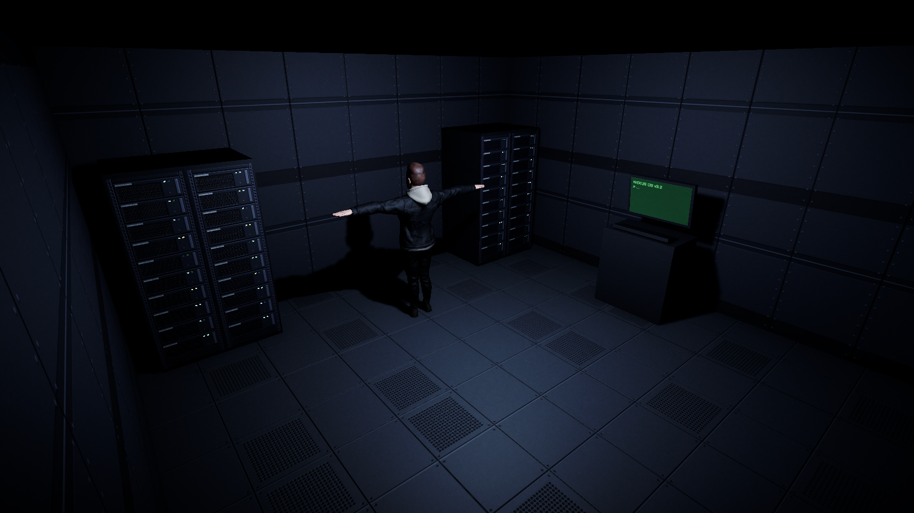

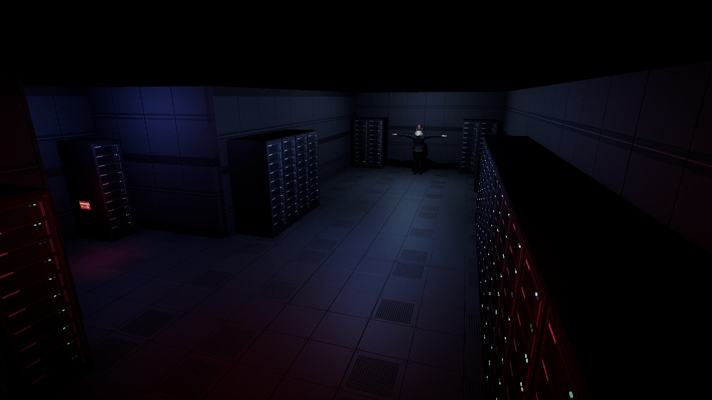

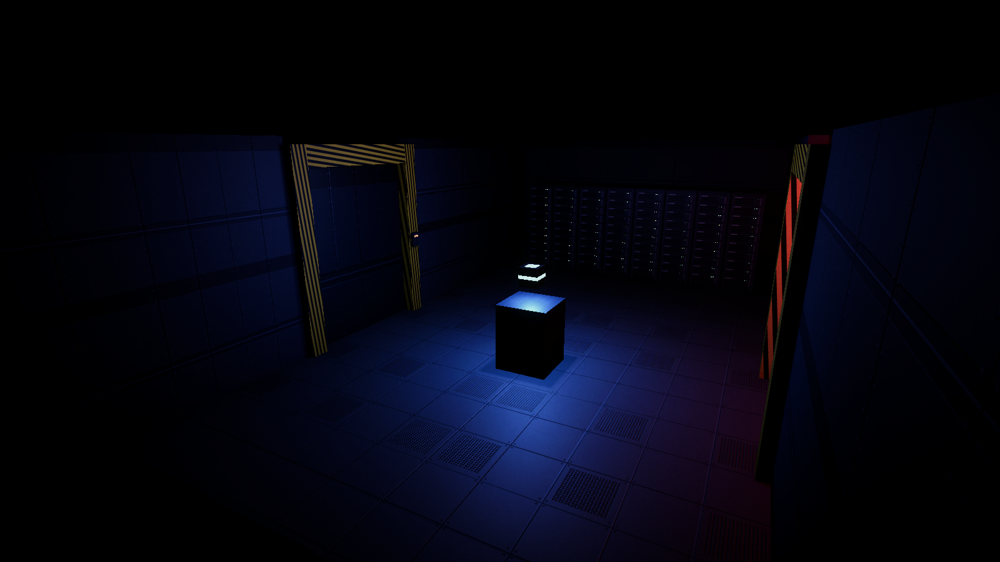

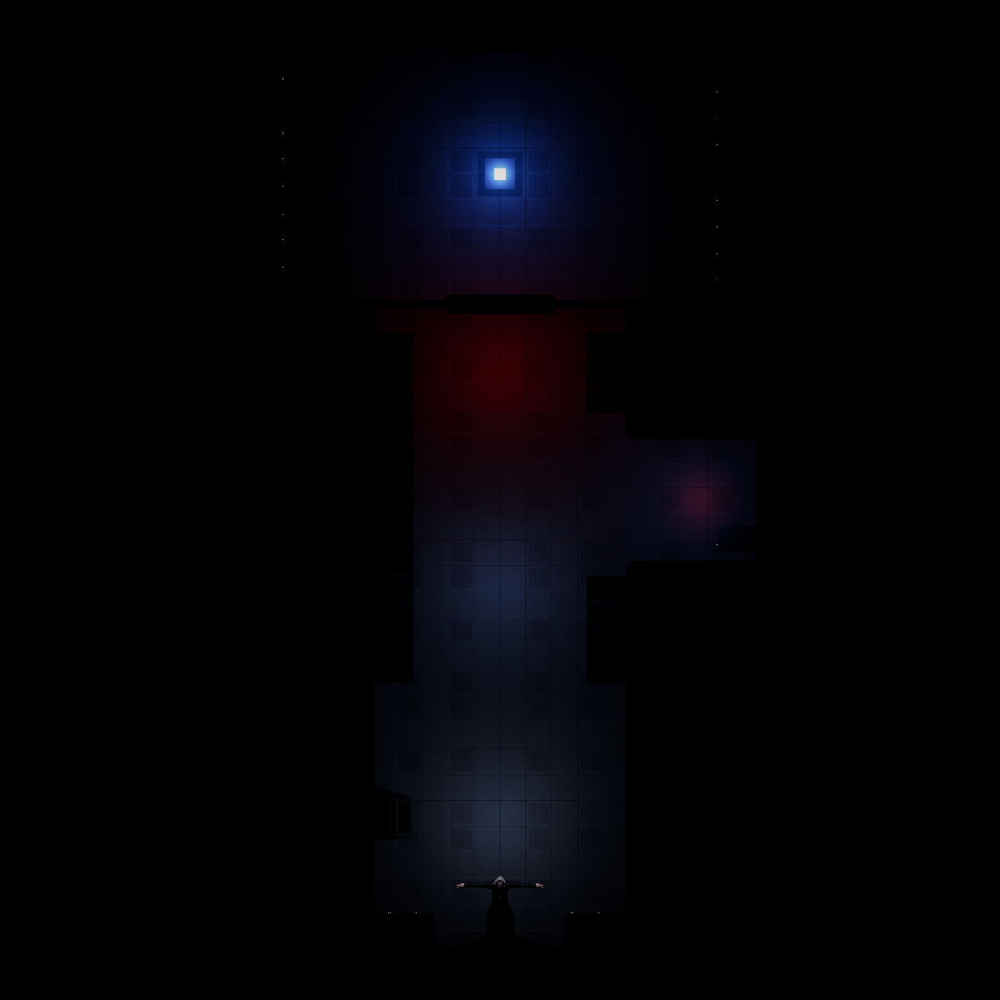

> **Decisión de diseño (11/11/2026):** este trazado es una **base técnica**. Los niveles finales
> serán más grandes, con varias salas y objetivos encadenados (fusibles, códigos, notas, objetos de
> curación, guardado), para que el resultado sea un juego completo y no una demostración.

---

## Fase 7 (adelanto) — Builds de prueba en las tres plataformas

Para detectar problemas de exportación desde el principio (y no el día de la entrega), se
compilaron versiones de prueba en cuanto hubo contenido.

### 7.1 Build de Windows — 11/11/2026 · [Programación]

- Perfil `Nexus_PC_Windows` → `Builds/Windows/Nexus.exe`.
- **Resultado: correcto.** 0 errores, 3 advertencias, 136 MB, 7 minutos de compilación.
- El ejecutable arrancó en ventana (Direct3D 11) y su registro (`Player.log`) no mostró errores.

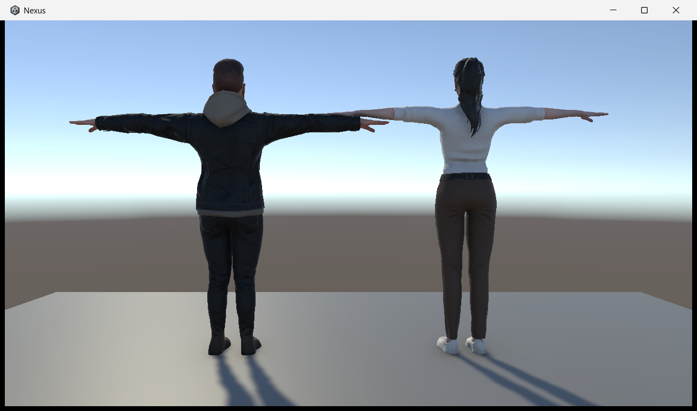

### 7.2 Build de WebGL (navegador) — 11/11/2026 · [Programación] · [Dificultad superada]

**Cómo se hizo:**
1. Cambio de plataforma activa a **Web** (*File → Build Profiles → Nexus_Web → Switch Profile*).
   Unity reimporta todas las texturas y recursos en los formatos que entiende un navegador; tardó
   unos 80 segundos.
2. Build con el perfil `Nexus_Web` → carpeta `Builds/Web`.
3. Prueba en local: un build WebGL **no se puede abrir con doble clic** sobre `index.html`; necesita
   un servidor web. Se sirvió con el servidor de Python (`py -m http.server 8090 --directory
   Builds/Web`) y se abrió en el navegador.

**Resultado:** correcto. 0 errores, 0 advertencias, **30 MB** en total (el código del juego
compilado a WebAssembly ocupa 9,6 MB y los datos 19,3 MB). El juego carga, muestra la escena y la
consola del navegador no registra errores. La plantilla web incluye el **botón de pantalla
completa** (abajo a la derecha), que pide la rúbrica para el juego embebido en el artículo.

**Problema encontrado:** el primer intento terminó como *"Building Player was cancelled"*
(`TaskCanceledException`) tras 8 minutos, en la etapa de compilar el código a WebAssembly. El
registro del compilador mostraba 159 de 410 archivos compilados **sin ningún error**: el build no
falló, se interrumpió desde fuera. La cancelación coincidió con el momento en que se detuvo el
proceso de la terminal que estaba consultando el estado del build.

**Solución:** repetir el build sin interrumpir ningún proceso mientras compila. Como Unity guarda
en caché lo que ya había compilado, el segundo intento reutilizó ese trabajo y terminó bien. El
build WebGL es el más lento de los tres (unos 13 minutos), porque convierte todo el código C# a C++
(IL2CPP) y luego a WebAssembly.

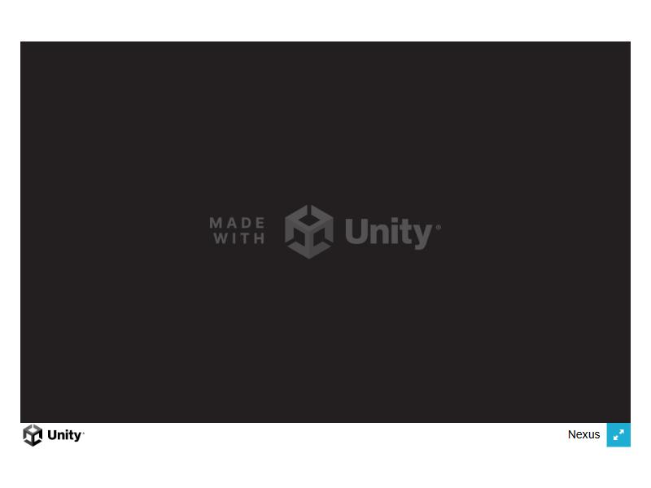

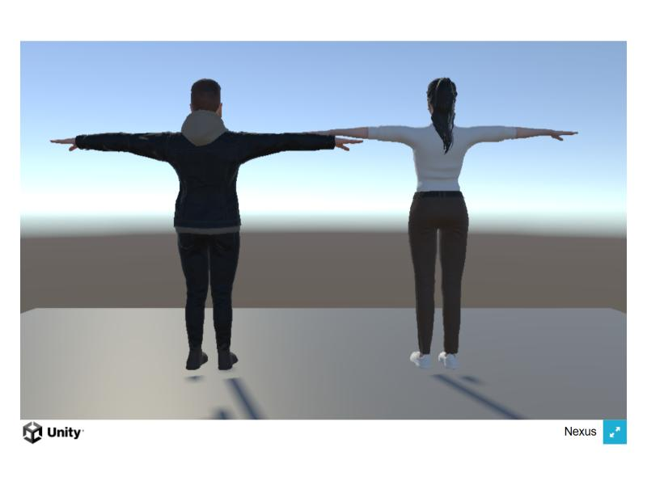

### 7.3 Build de Android (APK) — 11/11/2026 · [Programación] · [Dificultad superada]

**Cómo se hizo:**
1. Cambio de plataforma activa a **Android** (*Switch Profile* en `Nexus_Android`): unos 3 minutos
   de reimportación, con las texturas en formatos comprimidos para móvil.
2. Build con el perfil `Nexus_Android` → `Builds/Android/Nexus.apk`, con la configuración de la
   entrada 0.7: IL2CPP, ARM64, solo horizontal y el identificador `com.nexusteam.nexus`.

**Problema encontrado:** el primer intento terminó al instante, sin generar nada, con el error
*"Error building Player because scripts are compiling"*. Al cambiar de plataforma Unity recompila
los scripts (cada plataforma tiene sus propias directivas de compilación) y el build se pidió antes
de que terminara.

**Solución:** esperar a que la consola indique que la compilación terminó y volver a lanzar el build.

**Resultado:** correcto. 0 errores, 4 advertencias, **APK de 39,4 MB**. El primer build tardó unos
20 minutos: convierte el código C# a C++ con IL2CPP, lo compila para procesadores ARM64 y empaqueta la
aplicación con Gradle. Los siguientes serán más rápidos gracias a la caché. *Pendiente: instalarlo y
probarlo en un celular Android.*

### 7.4 Resumen de los builds de prueba

| Plataforma | Archivo | Tamaño | Tiempo del primer build | Estado |
|---|---|---|---|---|
| Windows | `Builds/Windows/Nexus.exe` | 136 MB (carpeta) | ~7 min | ✅ Probado: arranca y se ve |
| Web (WebGL) | `Builds/Web/index.html` | 30 MB | ~13 min | ✅ Probado en el navegador |
| Android | `Builds/Android/Nexus.apk` | 39 MB | ~20 min | ✅ Compila · ⏳ falta probarlo en un celular |

---

## Fase 2 (continuación) — Animaciones

### 2.5 Animaciones de Mixamo con el sistema Humanoid — 11/11/2026 · [Arte] · [Programación]

**Qué se hizo:** los integrantes subieron sus avatares a **Mixamo** y descargaron las animaciones
aplicadas sobre ellos. Se revisaron todos los archivos con Blender (duración, esqueleto y
desplazamiento de la cadera) y se eligieron 11 clips, que se copiaron a
`Assets/Nexus/Animaciones/Mixamo` con nombres en español:

| Clip | Archivo original | Uso en el juego | Bucle |
|---|---|---|---|
| Reposo | Neutral Idle | Quieto | Sí |
| Caminar | Walking | Moverse con el stick o WASD | Sí |
| Correr | Running | Mantener la tecla de correr | Sí |
| Caminar_Herido | Injured Walking | Caminar con la salud baja | Sí |
| Golpe | Hit Reaction | Al recibir daño de un androide | No |
| Caminar_Golpe | Walking Hit Reaction | Golpe mientras camina | No |
| Morir | Dying | Al quedarse sin salud | No |
| Pistola_Reposo / Pistola_Caminar / Disparar / Cuchillo | Pistol Idle, Pistol Walk, Shooting, Stabbing | Armas (si se implementan) | — |

**Cómo se configuraron** (herramienta `ConstructorAnimaciones.cs`, menú *Nexus → Personajes →
Configurar animaciones*):
- **Rig: Humanoid.** Cada archivo genera su propio Avatar, y Unity traduce el movimiento al esqueleto
  humano estándar. Por eso **los mismos clips funcionan en Neyder y en Deisy** (y servirán para los
  androides), aunque se hayan descargado sobre un solo personaje.
- **Root Transform Rotation y Position (Y): Bake Into Pose**, para que el clip no gire ni hunda al
  personaje.
- **Las animaciones no son "In Place":** la cadera avanza 1,7 m al caminar y 3,5 m al correr. En
  lugar de volver a descargarlas, el avance horizontal (XZ) se deja como *root motion* y el
  Animator lo descarta (*Apply Root Motion* desactivado). Así el personaje anima en su sitio y es el
  `CharacterController` el que lo desplaza.

**Animator Controller `AC_Tecnico`** (compartido por los dos avatares):

| Estado | Contenido | Se entra cuando… |
|---|---|---|
| **Locomocion** (Blend Tree) | Reposo (0) → Caminar (1,8) → Correr (5,0), mezclados según el parámetro `Velocidad` | Estado inicial |
| **Locomocion_Herido** (Blend Tree) | Reposo → Caminar_Herido | `Herido` = verdadero |
| **Golpe** | Hit Reaction; al terminar vuelve a Locomocion | Disparador `Golpe` (desde cualquier estado) |
| **Morir** | Dying | `Muerto` = verdadero |

Los umbrales del Blend Tree coinciden con las velocidades del `ControladorJugador` (1,8 m/s
caminando, 5 m/s corriendo), que a su vez son la velocidad real de las animaciones. Así los pies
no "patinan" sobre el suelo.

### 2.6 Prueba en modo Play y orientación del personaje — 11/11/2026 · [Dificultad superada]

**Problema detectado:** los avatares de Avaturn, en su pose de reposo (pose T), miran hacia −Z,
mientras que Unity usa +Z como "adelante". En el primer build de prueba los personajes del menú
salían de espaldas a la cámara.

**Verificación:** en modo Play, con la animación de reposo activa, el personaje **mira hacia +Z**: el
sistema Humanoid orienta el cuerpo según el objeto que tiene el Animator, sin importar cómo venía el
modelo. Por lo tanto el controlador funciona correctamente sin modificar los modelos.

**Prueba de movimiento:** se agregó al controlador una "entrada simulada" para hacer pruebas
automáticas sin teclado. Al simular la dirección "abajo", el técnico se gira hacia la cámara fija y
camina hacia ella a 1,8 m/s con la animación de caminar.

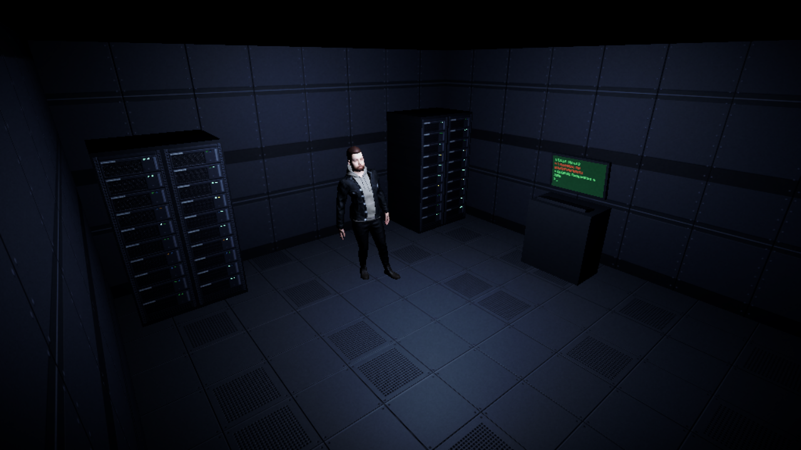

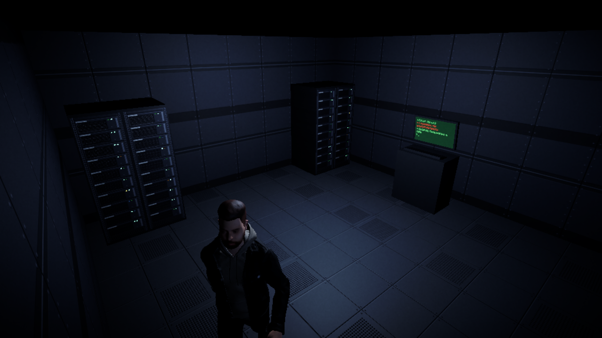

---

## Fase 1 (continuación) — Objetos de inventario y del nivel

### 1.10 Nuevos objetos — 12/11/2026 · [Arte]

Al ampliar el juego con inventario, puzles y guardado se modelaron nuevos objetos, también con
primitivas y texturas propias (menú *Nexus → Fase 1 → 4. Objetos del inventario y del nivel*):

| Objeto | Construcción | Uso |
|---|---|---|
| Fusible | Cilindro ámbar emisivo con tapas metálicas | Objeto de puzle: repara el panel eléctrico |
| Memoria USB | Cuerpo negro, conector metálico y luz cian | Se gasta al guardar la partida |
| Speedmax | Lata (cilindro) con textura propia: franjas verde lima. No usa logotipos reales | Recupera 1 corazón |
| Chocorramo | Bloque con envoltura naranja de diseño propio | Recupera toda la salud |
| Cartucho de refrigerante | Cilindro blanco y azul con banda de neón | Coleccionable con contador: +20 s |
| Mesa con nota | Mesa de 4 patas, portapapeles y hoja con "texto" procedural | Historia del juego (*lore*) y pistas |
| Panel de fusibles | Caja de pared con franja de peligro, 3 fusibles (uno vacío) y luz de estado | Puzle de energía |
| Terminal de respaldo | Consola con pantalla azul y ranura USB iluminada | Guardar la partida |
| Montacargas | Marco con franjas, puertas, cartel "MONTACARGAS" en TextMeshPro y botón | Salida del nivel |
| Fila de racks | 10 racks espalda con espalda, **combinados en 3 meshes** | Paredes de servidores en los niveles |

Los objetos que se recogen tienen una leve emisión para que se distingan en la oscuridad sin
gastar una luz cada uno.

**Optimización de la fila de racks:** con 10 racks sueltos, una sola celda de 3 × 3 m costaría unas
40 llamadas de dibujo. Combinando cuerpos, frentes y LEDs en tres meshes (`Mesh.CombineMeshes`),
la celda cuesta 3. Es lo que permite construir laberintos de cientos de racks que funcionen fluidos
en Android y WebGL.

---

## Fase 3 — Sistemas de juego

### 3.3 Arquitectura de los sistemas — 12/11/2026 · [Programación]

| Script | Responsabilidad |
|---|---|
| `EstadoPartida` | Datos que pasan de un nivel a otro: personaje elegido, salud, discos, refrigerantes, inventario y notas leídas. Guarda y carga la partida con `PlayerPrefs` (funciona igual en Windows, WebGL y Android) |
| `NivelNexus` | Uno por nivel: temporizador de refrigeración, temperatura (sube de 80 % a 100 % al agotarse el tiempo), objetivo inicial, Game Over por tiempo, paso al nivel siguiente y Victoria. Calcula la malla de navegación al cargar el nivel |
| `VidaJugador` | Las 3 **Oportunidades de Evasión**: al ser alcanzado pierde una, recibe un empujón y queda 2,5 s invulnerable. Con 1 camina herido (animación *Caminar_Herido*) y con 0 muere (animación *Morir*) y salta el Game Over |
| `Interactuable` + `InteraccionJugador` | Todo lo que se usa con el botón de interactuar (E): detecta lo que está cerca, muestra "[E] Usar terminal" y lo activa |
| `TerminalNexus`, `NotaLore`, `PanelFusibles`, `TerminalGuardado`, `SalidaNivel` | Los interactuables concretos (terminal, nota, puzle del fusible, guardado con USB y salida) |
| `Coleccionable` | Recoge objetos al tocarlos: los suma al inventario, muestra un aviso, actualiza el objetivo y puede lanzar un diálogo (la alarma del disco) |
| `PuertaSeguridad` | Ahora también admite puertas **sin energía** que se activan desde el panel de fusibles |
| `HUDNexus` | Interfaz de juego y pantalla final (ver 3.4) |
| `PantallaInventario` | Inventario, archivo y mapa (ver 3.5) |
| `ModeloJugador` | Coloca en el jugador el avatar elegido en el selector (Neyder o Deisy). Los dos comparten el mismo Animator gracias al sistema Humanoid |

**Comunicación entre sistemas:** los objetos no se conocen entre sí. Usan métodos estáticos del HUD
(`HUDNexus.Aviso`, `HUDNexus.Objetivo`, `HUDNexus.MostrarDialogo`) y eventos (`EstadoPartida.AlCambiar`,
`Coleccionable.AlRecoger`). Así, por ejemplo, la terminal no necesita saber cómo se dibuja un diálogo.

**Cuadros de diálogo:** el texto aparece letra a letra, como en una terminal (55 caracteres por
segundo con tiempo no escalado), y **el juego se pausa** (`Time.timeScale = 0`) mientras se lee. Se
avanza con E, Espacio, Enter, clic, el botón del mando o tocando la pantalla.

### 3.4 Interfaz: HUD (Canvas 2) y pantalla final (Canvas 3) — 12/11/2026 · [Diseño] · [Arte]

**Primera versión:** paneles con recuadros para la salud (3 corazones), el temporizador con barra de
temperatura y los contadores de discos y cartuchos.

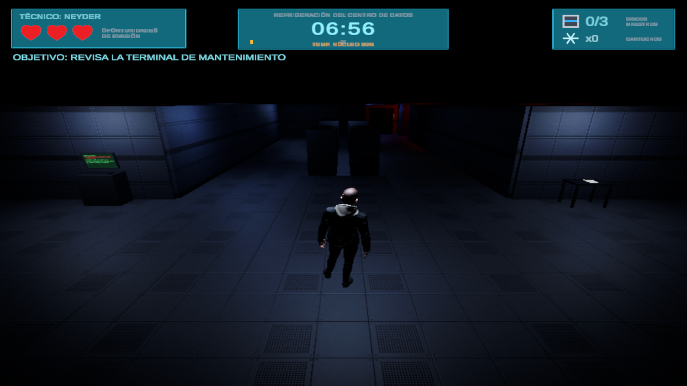

**Rediseño tras revisarlo en equipo:** los recuadros tapaban demasiado el escenario y la salud
siempre visible restaba tensión. El HUD final es **solo texto pequeño con una sombra suave**:
- Arriba a la izquierda, el **objetivo** actual.
- Arriba a la derecha, la **refrigeración** (temporizador), la temperatura del núcleo, los
  **discos (x/3)** y los **cartuchos**.
- La **salud no está fija en pantalla**: aparece unos segundos ("ESTADO: HERIDO" con los corazones)
  cada vez que cambia, y con un solo corazón los bordes de la pantalla laten en rojo. Así se sigue
  cumpliendo el requisito de "vidas en pantalla" sin recargar la vista. Siempre se puede consultar
  en el inventario.
- El único recuadro es el del cuadro de diálogo, porque un texto largo necesita fondo para leerse.

**Detalle técnico:** la sombra del texto es un material de TextMeshPro con *underlay* (una copia
oscura y difuminada detrás de cada letra), que se lee sobre cualquier fondo sin necesidad de panel.

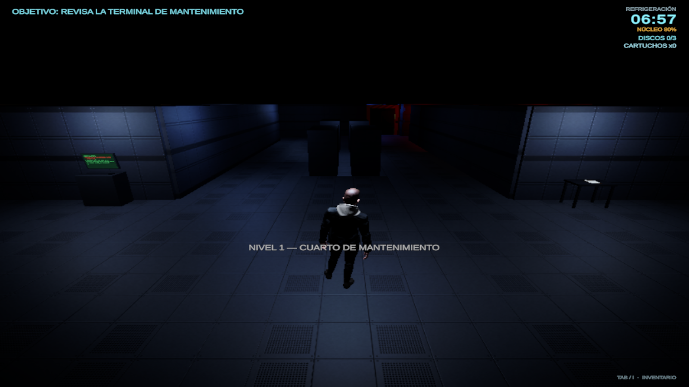

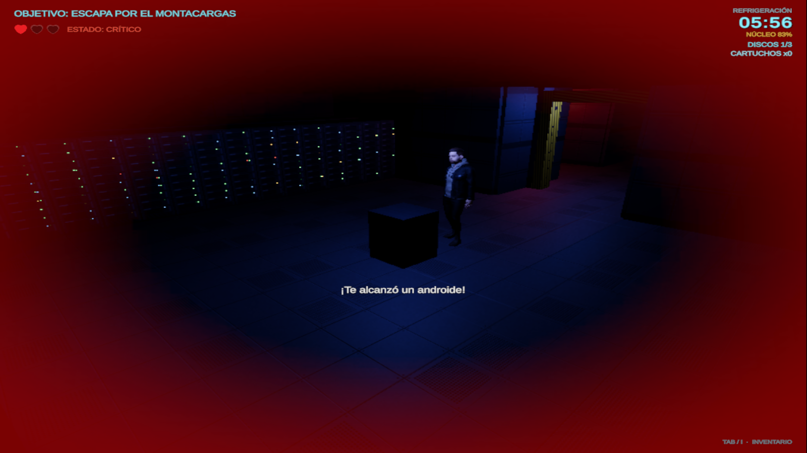

**Pantalla final (Canvas 3):** el mismo Canvas sirve para el **Game Over**
("COLAPSO TÉRMICO" si se acaba el tiempo, "ANOMALÍA PURGADA" si los androides atrapan al técnico) y
para la **Victoria**, con los botones *Reintentar nivel*, *Cargar partida guardada* y *Menú principal*.

### 3.5 Inventario: terminal portátil del técnico — 12/11/2026 · [Diseño] · [Arte] · [Programación]

Se abre con **TAB** o **I** (o con el botón táctil en Android), pausa el juego y oculta el HUD. Su
estructura se inspira en los inventarios del survival horror clásico, con un diseño visual propio
de Nexus (sistema operativo de terminal, tonos cian):

- **Panel del técnico:** retrato, nombre y rol, **monitor de signos vitales** (una línea de pulso
  que se desplaza más rápido y cambia de color según el estado: verde *ESTABLE*, ámbar *HERIDO*,
  rojo *CRÍTICO*), corazones y resumen de la misión (discos, cartuchos, tiempo y notas leídas).
- **OBJETOS:** cuadrícula de 8 casillas, vista previa grande del objeto seleccionado y su
  descripción. El Speedmax y el Chocorramo se **usan** desde aquí para curarse.
- **ARCHIVO:** las notas leídas, para releerlas.
- **MAPA:** plano esquemático del nivel con el nombre de cada sala, las puertas por color, los
  puntos de interés y la **posición del jugador** parpadeando.

**Cómo se hicieron los gráficos:**
- **Retratos:** se fotografiaron los avatares 3D de los integrantes desde la herramienta de editor.
  Se abre una escena temporal con luz de estudio, se coloca una cámara frente a la cabeza (el hueso
  *Head* del Avatar Humanoid) y se renderiza a un PNG.
- **Íconos de objetos:** igual, fotografiando cada prefab con fondo transparente.
- **Línea de pulso:** textura generada por código, con la forma de un electrocardiograma.
- **Mapa:** se genera desde el mismo mapa de texto del nivel (ver 6.2), dibujando cada celda.

**Problema encontrado:** en pantallas que no eran exactamente 16:9, la columna derecha del
inventario se salía de la pantalla. **Solución:** el escalado de todos los Canvas pasó a modo
**Expand**, que garantiza que la resolución de referencia (1920 × 1080) quepa siempre completa, y
las páginas se anclaron a ambos lados de la pantalla. Así la interfaz se adapta a PC, navegador y
celular.

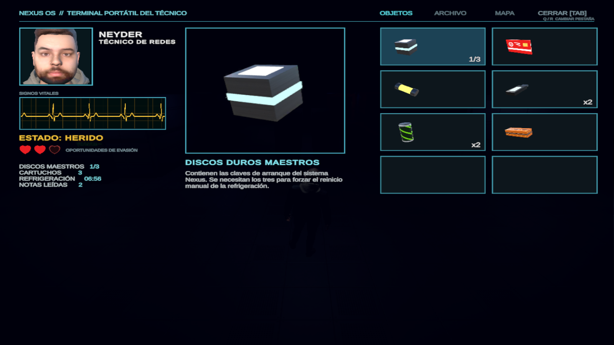

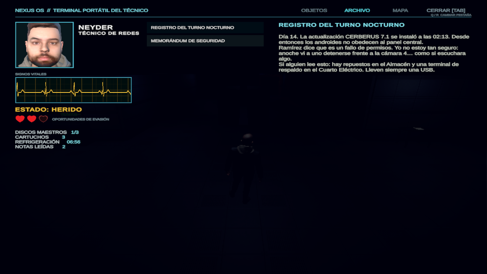

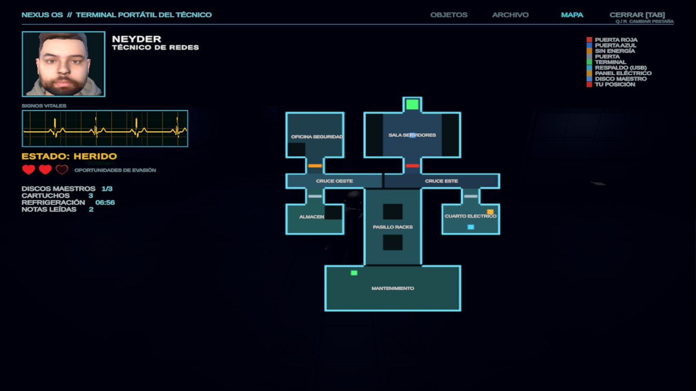

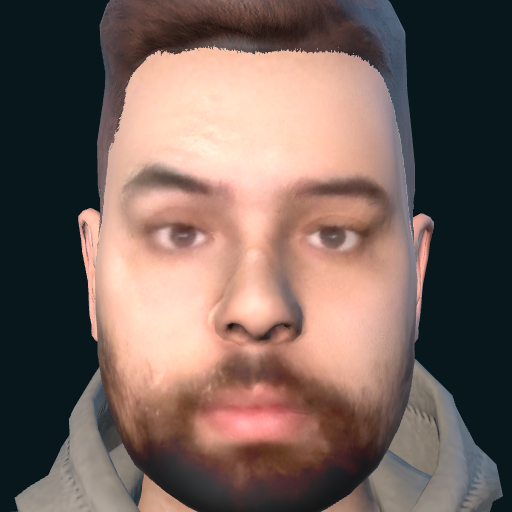
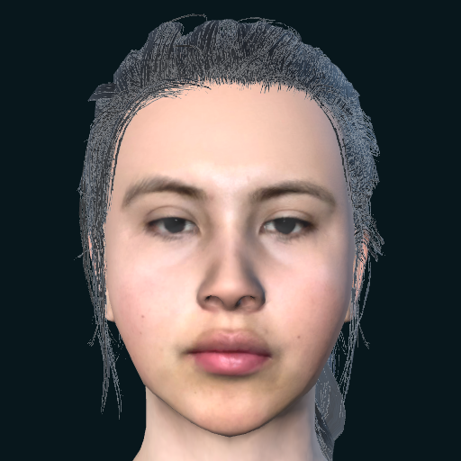

---

## Fase 6 — Niveles

### 6.2 Constructor de niveles a partir de mapas de texto — 12/11/2026 · [Diseño] · [Programación]

Para hacer niveles grandes en poco tiempo, cada nivel se **dibuja como texto**, donde cada carácter
es una celda de 3 × 3 m. Una herramienta (`ConstructorNiveles.cs`, menú *Nexus → Niveles*) lo
convierte en el nivel 3D:

| Carácter | Significado | Carácter | Significado |
|---|---|---|---|
| `#` | muro | `.` | suelo |
| `=` `\|` | fila de racks (horizontal / vertical) | `S` | inicio del jugador |
| `T` | terminal con mensajes | `G` | terminal de guardado |
| `P` | panel de fusibles | `n` | nota |
| `R` `B` | puerta roja / azul | `X` | puerta sin energía |
| `L` | puerta normal | `E` | montacargas (salida) |
| `D` | Disco Duro sobre pedestal | `A` | androide |
| `k` `a` | tarjeta roja / azul | `f` `u` | fusible / USB |
| `m` `c` `g` | Speedmax / Chocorramo / refrigerante | | |

Una segunda capa de letras agrupa las celdas en **salas**. Para cada sala, la herramienta:
- coloca suelo y paredes automáticamente donde el suelo toca un muro;
- reparte sus **luces** por "punto más lejano" (una luz cada ~5 celdas, bien distribuidas);
- crea su **cámara fija** en la esquina indicada, mirando al centro de la sala (o en una posición
  manual cuando la sala lo necesita), y las **zonas de cambio de cámara** en cada celda;
- genera la imagen del **mapa** para el inventario.

**Nivel 1 — Cuarto de Mantenimiento (39 × 48 m, 8 salas):**

```
#############
#######E#####     E  montacargas (salida)
#n.k#|...|###     oficina de seguridad   |   sala de servidores
#...#|.D.|###
#=..#|...|###
##X####R#####     X  puerta sin energía  R  puerta roja
#...........#     cruce de pasillos
##L##...##L##
#f.=#.|.#u.P#     almacén  |  pasillo de racks  |  cuarto eléctrico
#mg.#...#.G.#
#####.|.#####
#####...#####
###.T...n.###     sala de mantenimiento (inicio)
###...S...###
###.m.....###
#############
```

**Cadena de objetivos:** terminal (misión) → la oficina no tiene energía → el panel del cuarto
eléctrico pide un fusible → fusible en el almacén → panel reparado: se encienden las luces y se abre
la oficina → tarjeta roja → puerta roja → Disco Maestro 1 (alarma) → montacargas.

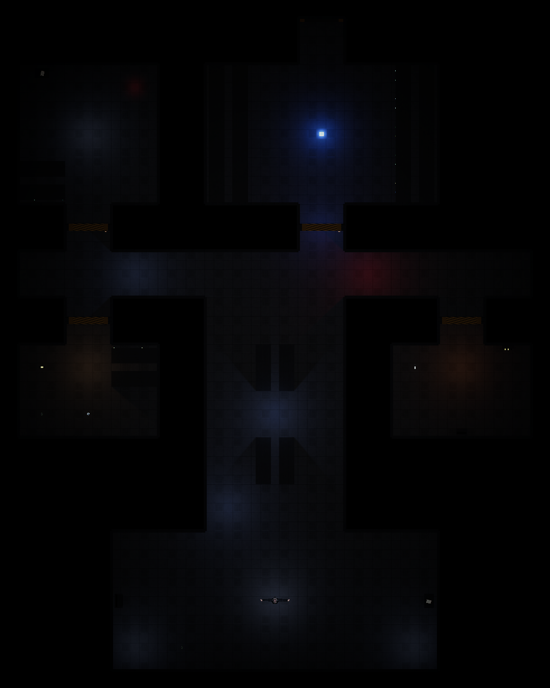

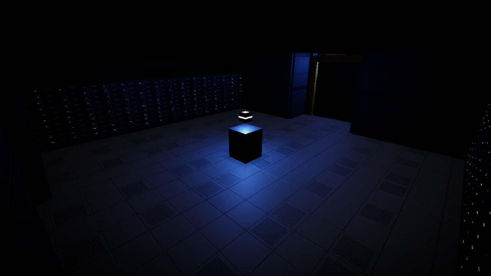

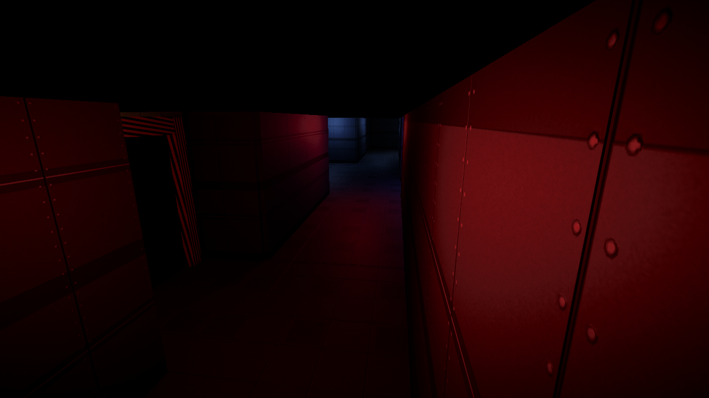

**Problemas encontrados y soluciones:**
1. **Encuadre de la sala inicial:** la cámara automática de esquina quedaba pegada a la pared y la
   terminal y la nota quedaban fuera de cámara. Se añadió a la herramienta la opción de fijar la
   cámara a mano, y la terminal y la nota se movieron a la pared que mira a la cámara.
2. **Salas largas demasiado oscuras:** se pasó de una luz cada 7 celdas a una cada 5 (redondeando
   hacia arriba) y se aclaró un poco la luz ambiente.
3. **Notas con el texto intercambiado:** la herramienta recorría el mapa de abajo arriba, pero los
   textos se escriben en orden de lectura. Se cambió el recorrido a arriba-abajo.

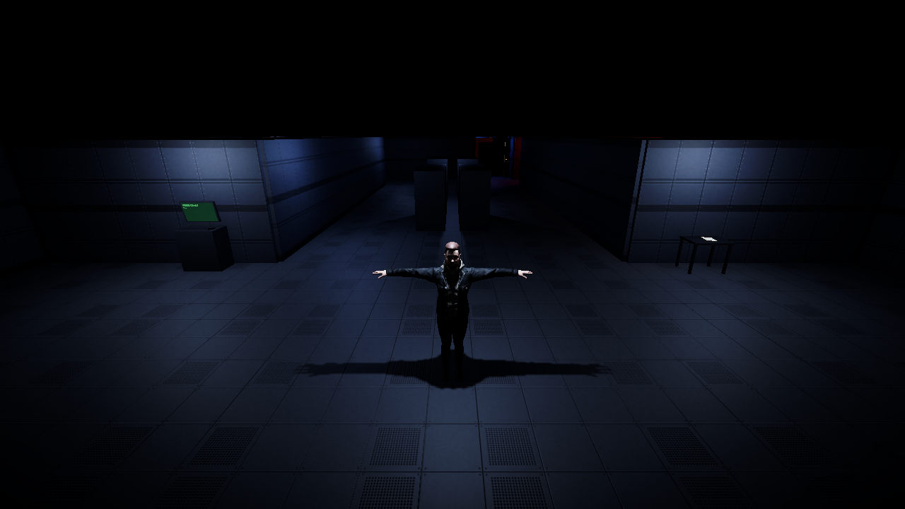

### 6.3 Prueba completa del Nivel 1 — 12/11/2026 · [Dificultad superada]

Se jugó el nivel de principio a fin en modo Play, con un script de prueba que lleva al técnico a
cada punto y simula la tecla de interactuar:

| Paso | Resultado esperado | ¿Correcto? |
|---|---|---|
| Inicio | Objetivo "Revisa la terminal", temporizador 7:00, aviso con el nombre del nivel | ✅ |
| Terminal | 5 mensajes de alerta; al cerrarlos, el objetivo cambia a la tarjeta | ✅ |
| Puerta de la oficina | "SIN ENERGÍA. Restablece el suministro en el Cuarto Eléctrico." | ✅ |
| Panel sin fusible | Diálogo de error; objetivo: buscar un fusible en el Almacén | ✅ |
| Fusible | Aviso "Obtuviste: Fusible"; objetivo: instalarlo en el panel | ✅ |
| Panel con fusible | Energía restablecida; luces de la oficina encendidas; puerta activa | ✅ |
| Tarjeta roja | Se recoge; objetivo: abrir la puerta roja | ✅ |
| Puerta roja | "Acceso concedido" y se abre | ✅ |
| Disco Maestro | Discos 1/3, alarma, objetivo "Escapa por el montacargas" | ✅ |
| Dos golpes de androide | Salud 3 → 1, indicador de estado y borde rojo | ✅ |
| Montacargas | Carga el Nivel 2 conservando el disco (1/3) | ✅ |

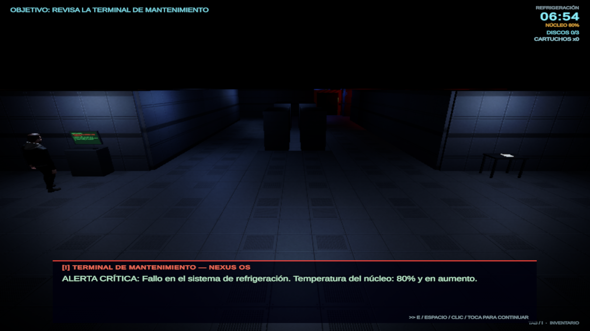

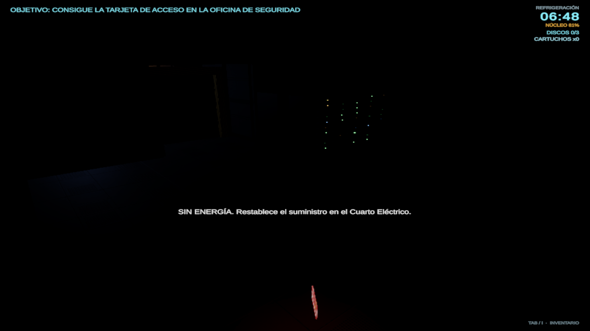

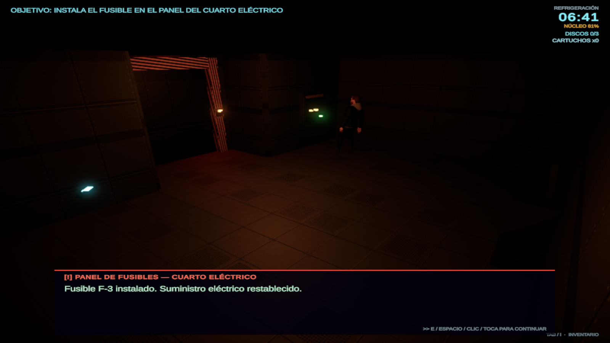

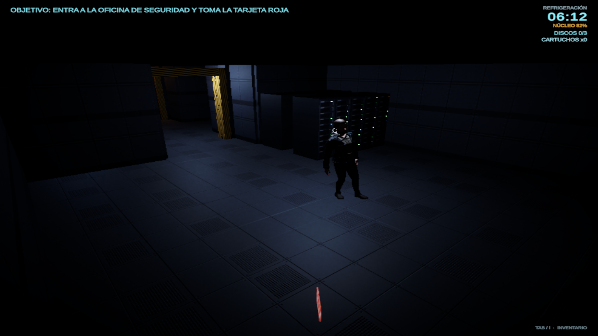

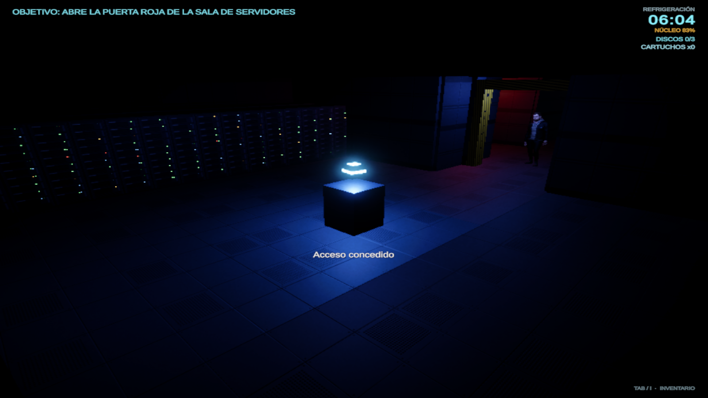

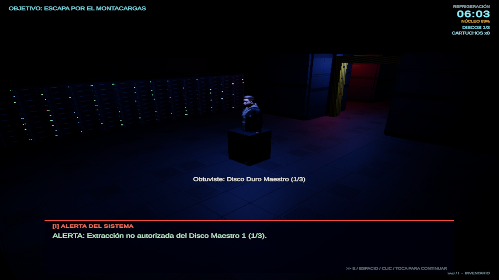

**Problema encontrado en la prueba:** al usar una nota se abrió el diálogo de la terminal. El
jugador "recordaba" la terminal como cercana: al aparecer de golpe en otro lugar (teletransporte de
la prueba, que también ocurre al cargar una partida), Unity no avisa de que salió de la zona del
objeto anterior. **Solución:** el jugador solo interactúa con objetos a menos de 4 m, lo que descarta
cualquier entrada vieja.

---

## Fase 4 — Inteligencia artificial: Androides de Seguridad SENTINEL

### 4.1 Modelo del androide — 12/11/2026 · [Arte]

**Qué se hizo:** el androide se construyó con el **Y Bot de Mixamo**, configurado como **Avatar
Humanoid** (avatar válido, mallas *Alpha_Surface* y *Alpha_Joints*). Gracias al sistema Humanoid usa
las **mismas animaciones** que los técnicos (reposo, caminar y correr) sin descargar nada más.

**Aspecto (herramienta `ConstructorAndroides.cs`, menú *Nexus → Enemigos → Construir androide*):**
- Cuerpo de **metal negro pulido** (`M_Androide_Cuerpo`).
- **Juntas que brillan** (`M_Androide_Juntas`, con emisión): en la oscuridad se ve la silueta del
  androide antes que su cuerpo.
- **Visor rojo** pegado al hueso de la cabeza, con el shader de LEDs en modo pulso.
- **Linterna roja** (*Spot Light*) que marca hacia dónde mira, como pedía el diseño.

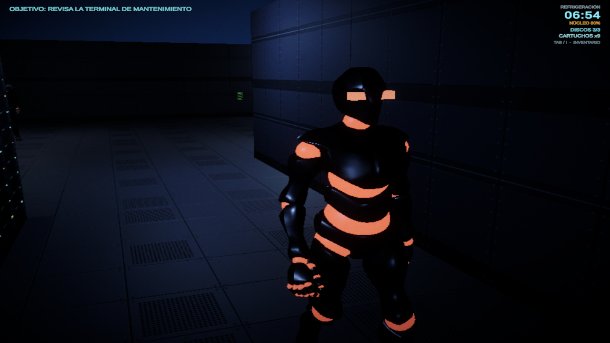

### 4.2 Comportamiento: máquina de estados — 12/11/2026 · [Programación] · [Diseño]

**Componentes del prefab `Androide_Sentinel`:** NavMeshAgent, Rigidbody cinemático, Capsule
Collider, `AndroideIA`, la linterna y el **cono de visión**: un *Mesh Collider* convexo con forma de
cono (8 lados, 9 m de alcance, 55° de apertura) en modo **Trigger**, con el script `ConoVision`.

**Estados de `AndroideIA`:**

| Estado | Comportamiento | Pasa a… |
|---|---|---|
| **Inactivo** | Apagado (linterna apagada) | *Búsqueda* cuando se extrae un Disco Maestro (alarma) |
| **Patrulla** | Recorre sus puntos de ruta a paso lento y espera un momento en cada uno | *Persecución* si ve al jugador; *Búsqueda* si lo oye correr cerca |
| **Persecución** | Corre hacia el jugador; la linterna se intensifica y parpadea | *Recalibrando* si lo alcanza; *Búsqueda* si lo pierde de vista 3 s |
| **Búsqueda** | Va al último lugar donde vio u oyó al jugador y mira alrededor 4 s | *Persecución* si lo ve; *Patrulla* (punto de ruta más cercano) si no |
| **Recalibrando** | Se detiene 2,5 s tras alcanzar al jugador (le da tiempo a huir) | *Patrulla* |

**Cómo "ve":** el cono de visión avisa cuando el jugador entra. Entonces el androide lanza un **rayo**
desde sus ojos hacia el pecho del jugador. Si choca antes con un rack o una pared, no lo ve. Así, en
el juego, **esconderse detrás de los racks funciona**. A menos de 1,6 m lo "siente" aunque esté a su
espalda.

**Cómo "oye":** si el jugador **corre** a menos de 5 m, el androide va a investigar. Caminar es la
forma sigilosa de moverse.

**Malla de navegación:** el objeto `Nivel` tiene un **NavMeshSurface** que se calcula al cargar el
nivel, usando los colliders del suelo, las paredes y las filas de racks. Las puertas cerradas llevan
un **NavMeshObstacle** que corta la malla hasta que se abren. Los androides se colocan fuera del
objeto `Nivel` para no contar como obstáculos de su propia malla.

**Androides del Nivel 1 (tutorial):**
- **Androide 1:** patrulla lenta (1,3 m/s) y predecible, dando la vuelta a los racks del pasillo.
  Enseña la mecánica.
- **Androide 2:** está **apagado** en el cruce de pasillos y se **activa con la alarma** al extraer el
  Disco Maestro.

### 4.3 Pruebas de la IA en modo Play — 12/11/2026 · [Dificultad superada]

| Prueba | Resultado |
|---|---|
| Patrulla | El androide 1 recorre su ruta a 1,3 m/s; el androide 2 permanece inactivo |
| Jugador escondido entre los dos bloques de racks | **No lo detecta**: el androide pasa por los lados mirando al frente. El hueco funciona como escondite |
| Jugador en el camino del androide | Lo detecta en 0,5 s (cono = verdadero) y corre a 3,6 m/s |
| Alcance | Salud 3 → 2, empujón y el androide queda *Recalibrando* |
| Jugador inmóvil frente al androide | Tras recalibrar lo vuelve a atrapar dos veces más → **Game Over** (comportamiento correcto) |
| Alarma del disco | El androide 2 pasa de *Inactivo* a *Búsqueda* y camina hacia la sala de servidores |

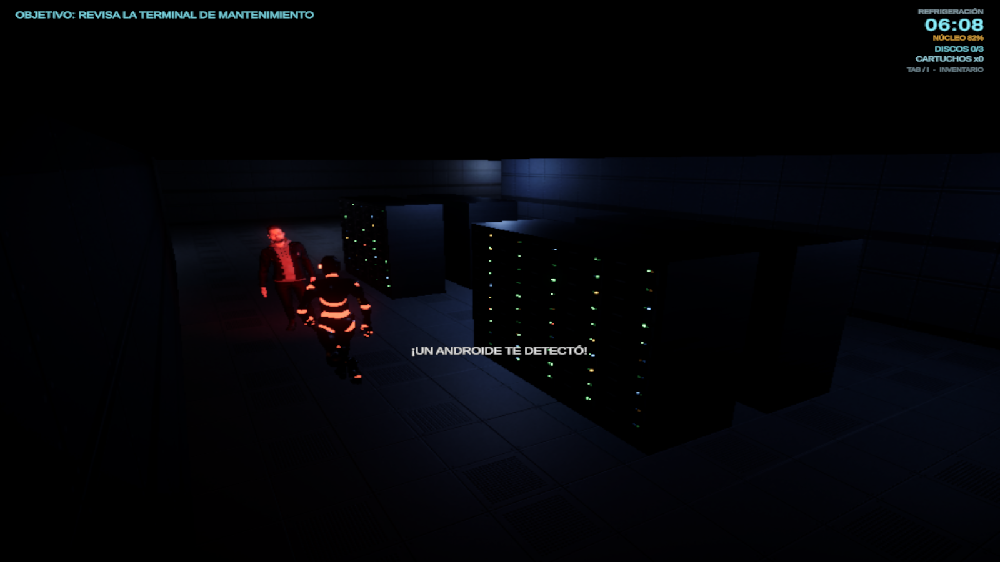

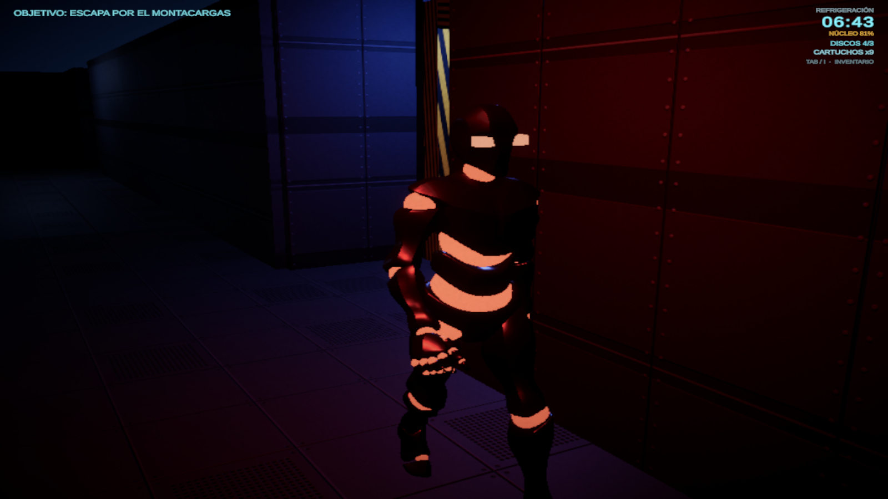

**Problema encontrado:** en el editor, los datos de la partida (discos, salud) se arrastraban de una
prueba a la siguiente: una captura llegó a mostrar "DISCOS 4/3". Con la recarga de dominio
desactivada, Unity no reinicia los campos estáticos al pulsar Play. **Solución:** un método con
`[RuntimeInitializeOnLoadMethod]` reinicia `EstadoPartida` al arrancar. En los builds no ocurría,
pero ahora las pruebas también empiezan limpias.

---

## Fase 3 (continuación) — Pantalla final rediseñada

### 3.6 Pantalla de Game Over y Victoria — 12/11/2026 · [Diseño] · [Arte] · [Programación]

**Primera versión:** un fondo rojo con el título y tres botones. Al revisarla en equipo se vio
"demasiado simple", y además tenía dos fallos: el fondo no cubría toda la pantalla (la imagen
conservaba la proporción cuadrada de su sprite) y el HUD se veía por encima.

**Rediseño:** la pantalla final es ahora un **fallo crítico del sistema Nexus**, animado paso a paso
(script `PantallaFinal.cs`, todo con tiempo no escalado porque el juego queda en pausa):

1. **Entrada:** destello blanco y estática fuerte, como un monitor que se apaga de golpe.
2. **El ojo del SENTINEL:** tres anillos de radar (marcas cada 6° y 30°, arcos y anillo punteado)
   que llegan desde fuera y giran a distintas velocidades, con un **núcleo luminoso que late**.
3. **Título glitch:** se escribe letra a letra con dos copias desfasadas, una roja y otra cian, que
   imitan la aberración cromática de una pantalla dañada. Cada pocos segundos toda la pantalla se
   descuadra un instante y sube la estática.
4. **Retrato del técnico** teñido de rojo, con estática encima y el rótulo "SEÑAL BIOMÉTRICA PERDIDA".
5. **Registro de terminal** que se escribe solo. Su contenido cambia según la causa: atrapado por un
   androide ("PROTOCOLO SENTINEL: PURGA EJECUTADA…") o colapso térmico ("RACKS B-1 A B-9: EN
   COMBUSTIÓN…").
6. **Monitor de pulso:** dibuja los últimos latidos, cada vez más débiles, hasta quedar en línea plana.
7. **Informe del incidente:** nivel, discos, cartuchos, notas, oportunidades y tiempo.
8. **Comandos** con estilo de consola (`[ REINTENTAR NIVEL ]`, `[ CARGAR RESPALDO ]`,
   `[ MENÚ PRINCIPAL ]`) que entran deslizándose desde abajo.

Encima de todo hay **líneas de escaneo** que bajan y **estática** que cambia en cada cuadro. Todos los
gráficos (anillos, núcleo, estática, líneas, rejilla y trazo del pulso) se **generan por código**.

**Victoria:** la misma pantalla en **verde/cian**: "SISTEMA RESTAURADO", retrato limpio con "MISIÓN
CUMPLIDA", pulso latiendo estable y un registro del reinicio del sistema.

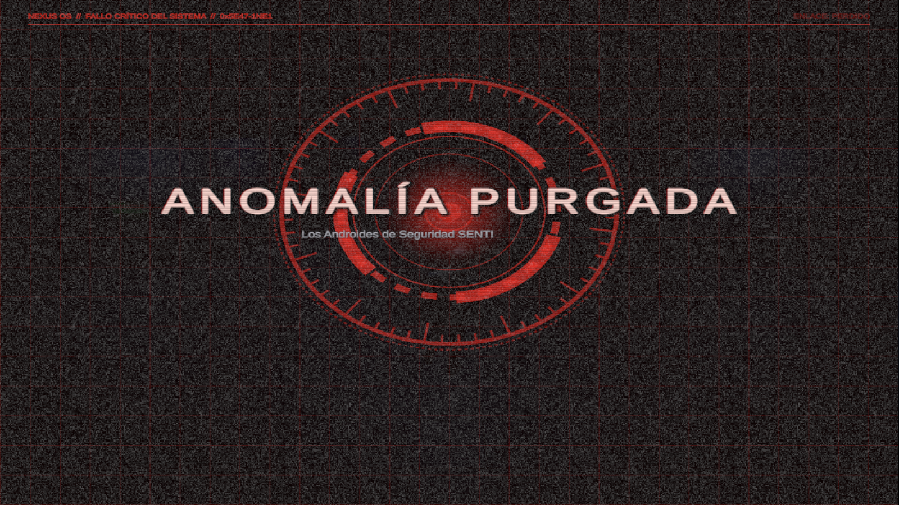

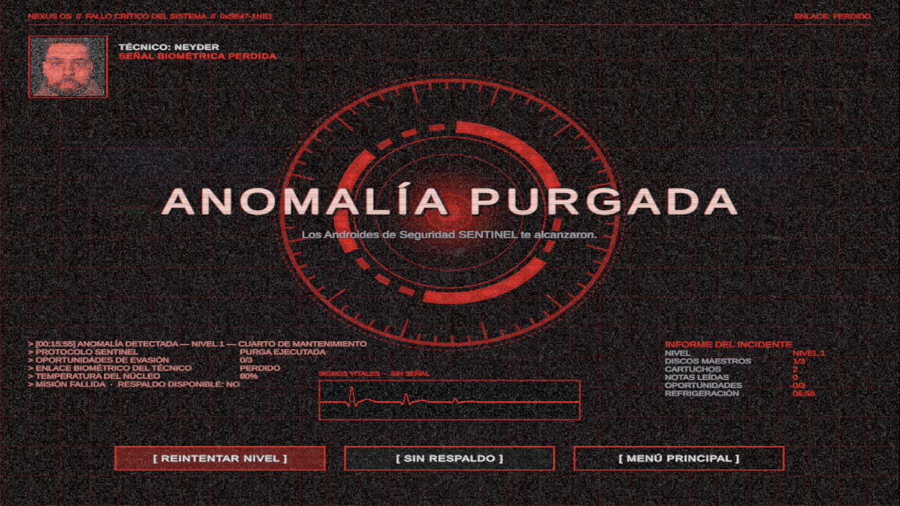

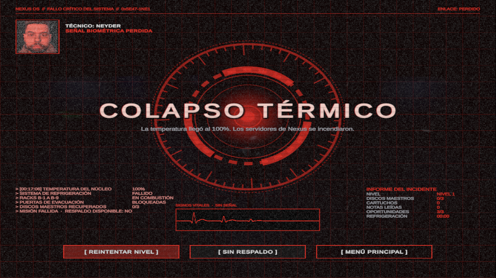

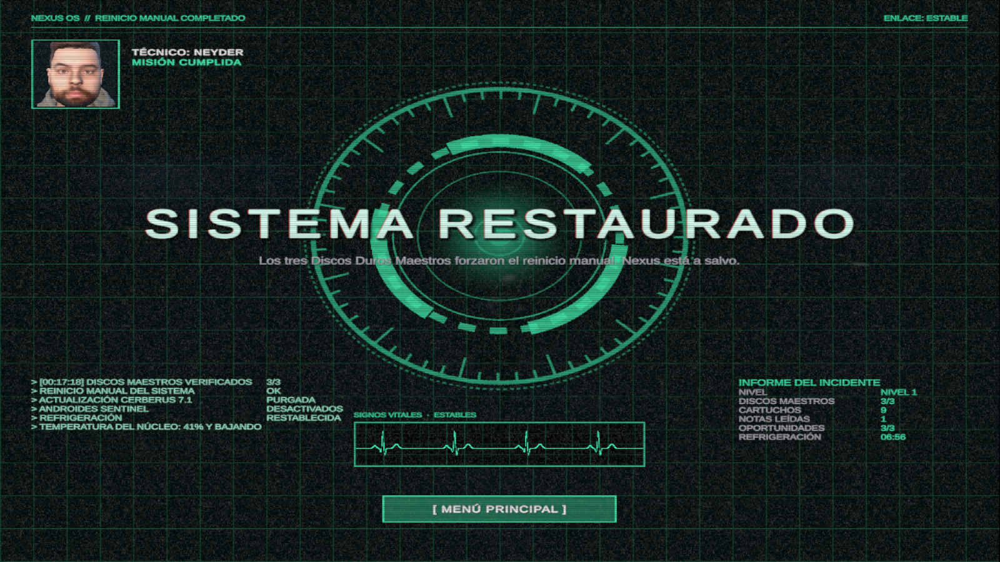


---

## Fase 6 (continuación) — Menú principal (Canvas 1)

### 6.4 Menú principal, selector de personaje, briefing y créditos — 12/11/2026 · [Diseño] · [Arte] · [Programación]

**Qué se hizo:** la escena `00_Menu` (la primera del build) con el **Canvas 1** del juego. No es un
fondo plano: detrás de la interfaz hay un **pasillo 3D del centro de datos** con filas de racks y sus
LEDs parpadeando, los **dos técnicos (los avatares de Neyder y Deisy)** de pie sobre plataformas con
anillos de luz y, al fondo, un **androide SENTINEL** iluminado en rojo. La cámara se mueve sola entre
dos planos (título y selector) con un balanceo suave, como si fuera una cámara de seguridad.

**Cómo se construyó:** igual que los niveles, la escena se genera con una herramienta de editor
(`Nexus/Interfaz/Construir menú principal`, archivo `ConstructorMenu.cs`) que coloca el escenario, las
luces, la cámara y los cuatro paneles de la interfaz. El comportamiento está en `MenuPrincipal.cs`.

El Canvas 1 tiene **cuatro pantallas**:

1. **Título:** logo NEXUS con efecto *glitch* (dos copias del texto, roja y cian, que se desplazan un
   instante cada pocos segundos), subtítulo, opciones y un recuadro reservado para el **logo
   institucional**. Abajo a la derecha parpadea el aviso "ALERTA · TEMPERATURA DEL NÚCLEO 78%".
   - **Continuar** solo aparece si hay una partida guardada (guardado de las terminales de respaldo).
   - **Salir** se oculta en la versión WebGL, porque en el navegador no hay aplicación que cerrar.
   - Las opciones visibles se reacomodan para que no queden huecos.
2. **Selector de personaje (Avatar Humanoid):** se elige con A/D, flechas, cruceta del mando o los
   botones `<` `>`. El técnico elegido recibe un foco de luz fuerte, su anillo se enciende en cian
   (se cambia el color por `MaterialPropertyBlock`, sin duplicar materiales) y gira despacio; el otro
   queda en penumbra. A la izquierda aparece su ficha (nombre, modelo, ID, turno, especialidad).
3. **Briefing (explicación del objetivo):** al confirmar se llama a `EstadoPartida.NuevaPartida()`
   con el personaje elegido y aparece el **informe de misión**, que se escribe letra a letra junto al
   retrato del técnico: qué pasó en el centro de datos, el objetivo (recuperar los 3 Discos Duros
   Maestros antes del colapso térmico) y las amenazas. **Iniciar misión** hace un fundido a negro y
   carga el Nivel 1.
4. **Créditos:** materia, institución, programa, docente, periodo, integrantes con su rol y
   herramientas usadas, más espacio para hasta tres logos.

**Créditos editables sin tocar código:** los textos de los créditos no están escritos en el script;
salen de un **archivo de datos** (`ScriptableObject`) en `Assets/Nexus/Datos/Creditos.asset`. Desde el
Inspector de Unity se pueden escribir los nombres completos, el docente y el semestre, y arrastrar los
logos en PNG; el menú los muestra solos (en el título y en los créditos) la próxima vez que se juegue.

**Personaje elegido → nivel:** en `01_Mantenimiento` el jugador lleva el componente `ModeloJugador`,
que lee el personaje guardado en `EstadoPartida` y coloca el avatar correspondiente antes que el resto
de scripts. Como los dos avatares son Humanoid y comparten el mismo Animator Controller, el movimiento,
las animaciones y la IA funcionan igual con cualquiera. Prueba en modo Play: Nueva partida →
seleccionar a Deisy → Confirmar → Iniciar misión → el Nivel 1 arranca con el avatar de Deisy
(`DeisyAvatar`) y el HUD del nivel.

**Dificultad superada — los créditos salían vacíos:** la primera prueba mostraba el texto de
respaldo "Falta el archivo de datos de créditos", aunque el archivo existía y era válido. Al revisar
la escena guardada, la referencia del menú al archivo estaba vacía (`datos: {fileID: 0}`). La causa:
la herramienta cargaba el archivo **antes** de abrir la escena, y `EditorSceneManager.OpenScene` en
modo *Single* descarga los recursos que no están en uso, así que la referencia quedaba apuntando a un
objeto ya destruido. Se corrigió cargando el archivo **después** de abrir la escena; ahora la escena
guarda la referencia correctamente y los créditos muestran sus datos.

**Pendiente del equipo:** completar en `Creditos.asset` los campos marcados con `[COMPLETAR: …]`
(nombres completos, institución, programa, docente, semestre) y añadir los logos institucionales.

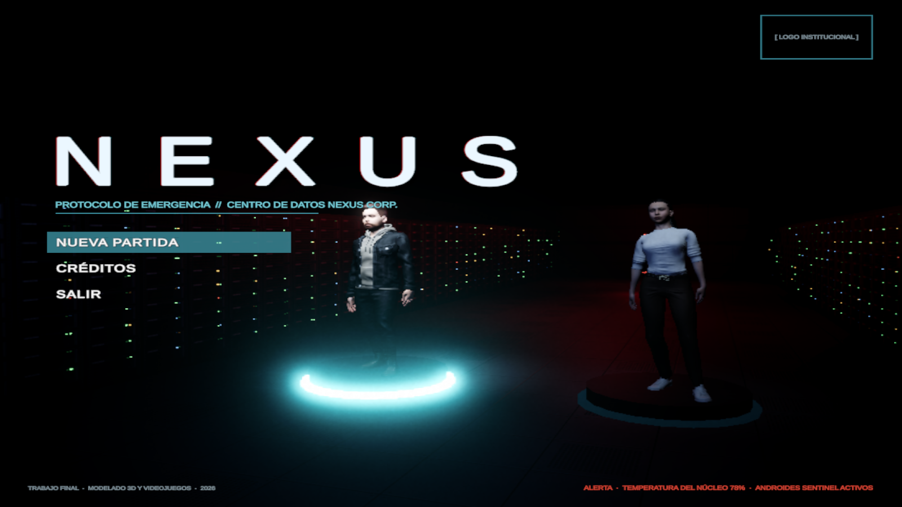

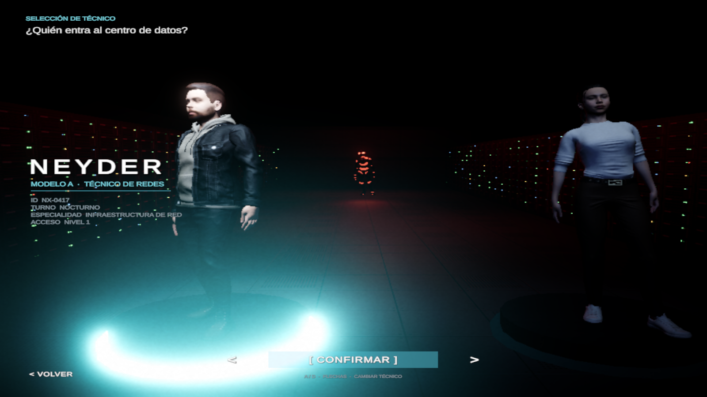


---

## Fase 3 (continuación) — Habilidades de los técnicos

### 3.7 Una habilidad distinta para cada personaje — 12/11/2026 · [Diseño] · [Programación]

**Idea del equipo:** que elegir a Neyder o a Deisy no sea solo un cambio de apariencia, sino una
forma distinta de jugar (más rejugabilidad). Cada técnico tiene una habilidad especial que se usa
con la tecla **Q** (botón Y/triángulo en el mando) y tiene un tiempo de recarga.

| Técnico | Habilidad | Qué hace | Recarga |
|---|---|---|---|
| **Neyder** (técnico de redes) | **Señuelo de red** | Lanza un repetidor de red que emite una señal falsa durante 8 s. Los androides a menos de 14 m van a revisarlo y se quedan ahí mirando alrededor. | 25 s |
| **Deisy** (analista de sistemas) | **KILLSWITCH.exe** | Ejecuta un programa de apagado sobre el androide más cercano que tenga a la vista (máx. 7 m). El androide se desploma, se le apagan el visor y las luces, y a los 10 s se reinicia. | 30 s |

**Equilibrio:** las dos habilidades resuelven el mismo problema de formas opuestas:

- **El señuelo de Neyder** se usa a distancia y puede distraer a varios androides a la vez. No es
  seguro: si un androide te ve camino al señuelo, te persigue igual.
- **El KILLSWITCH de Deisy** es seguro, pero solo afecta a uno y obliga a acercarse y tenerlo a la
  vista, con el riesgo que eso implica.

**Cómo se programó:**

- `HabilidadJugador.cs` va en el jugador. Lee el personaje elegido en el menú y activa la
  habilidad que le corresponde, controla la recarga y muestra el estado en el HUD
  (`Q · KILLSWITCH.exe · LISTA` en cian, o los segundos que faltan en gris).
- Se añadieron dos estados a la IA del androide (`AndroideIA.cs`):
  - **Apagado** (KILLSWITCH): se detiene, se reproduce la animación de caída y se apagan el visor y
    las juntas rojas con un `MaterialPropertyBlock`. En el último segundo y medio el visor parpadea
    (se está reiniciando), se levanta y vuelve a su ruta.
  - **Atraído** (señuelo y ruidos): el androide va al punto en estado de búsqueda y se queda ahí
    mientras dure la señal.
- **El rayo del KILLSWITCH** es un `LineRenderer` cian que salta en zigzag entre Deisy y el
  androide, con chispas al impactar.
- **El señuelo** (`SenueloRed.cs`) vuela en arco hasta donde cae. Mientras emite, muestra un anillo
  de pulso cian en el suelo y una luz parpadeante, y llama a los androides cercanos cada medio
  segundo. Al terminar se sobrecarga con un chispazo.
- **La ficha del selector** del menú ahora explica la habilidad de cada técnico, y al empezar cada
  nivel aparece un aviso recordándola.

**Dificultad superada — que el androide se levante:** el controlador de animaciones solo tenía la
transición "cualquier estado → Morir", sin vuelta atrás. Recrearlo desde cero le cambiaría su
identificador (GUID) y rompería las referencias en los prefabs y escenas. Por eso se agregó una
herramienta (`Nexus/Personajes/Agregar reinicio`) que añade la transición Morir → Locomoción sobre
el controlador existente.

**Pruebas en modo Play:**

1. **Neyder:** lanzó el señuelo frente a la sala de mantenimiento. El androide del pasillo pasó a
   Búsqueda y fue directo al repetidor. Cuando el jugador se quedó a la vista, el androide lo vio y
   lo atrapó, que es lo esperado.
2. **Deisy:** a 4 m de un androide, el KILLSWITCH lo dejó en estado Apagado durante 10 s. Luego se
   reinició y volvió a cazar.


---

## Fase 6 (continuación) — Ambientación de la empresa abandonada

### 6.5 Utilería, decoración automática y máquinas expendedoras — 12/11/2026 · [Arte] · [Diseño] · [Programación] · [Dificultad superada]

**Problema:** el nivel se veía "soso": paredes, racks y poco más. Nexus Corp. es una empresa de
tecnología abandonada a la fuerza, y eso tiene que notarse en los escenarios.

**Utilería nueva (48 objetos):** modelados con primitivas y texturas generadas por código, como el
resto del juego (`ConstructorUtileria*.cs`, menú `Nexus/Fase 1/5. Utilería y ambientación`).

- **Oficina:**
  - escritorios con PC (pantalla azul de error, consola con código verde, monitor apagado y
    caído, o lleno de cajas de mudanza);
  - isla de escritorios, sillas de oficina, archivador con un cajón abierto, casilleros (uno
    abierto con una chaqueta dentro);
  - consola de cámaras de seguridad con imagen de CCTV y estática;
  - pizarra con un diagrama y una X roja, carteles de la empresa ("EMPLEADO DEL MES:
    SENTINEL-04"), planta seca y dispensador de agua.
- **Cafetería:**
  - máquinas expendedoras "NEXUS FRESH" (bebidas) y "SNACK·BYTE" (ponqués), con productos detrás
    del vidrio y luz interior;
  - una máquina rota con el vidrio estrellado;
  - mesas con sillas plásticas (una volcada), mesón con cafetera y microondas, y nevera con notas.
- **Almacén y zona técnica:** estanterías con cajas, pilas de cajas, bobinas de cable, gabinetes
  eléctricos (uno abierto que echa chispas), carrito de herramientas y banco de trabajo con un
  servidor desarmado.
- **Abandono:** papeles por el suelo, latas aplastadas, bolsas de basura, canecas (una volcada con
  la basura regada), paneles del techo caídos, manchas, charcos, cables sueltos y conos con cinta
  de precaución.
- **Efectos:**
  - polvo flotando en cada sala (partículas);
  - chispas;
  - fluorescentes que titilan (`LuzParpadeante.cs`) en pasillos, cuarto eléctrico y cafetería.

**Optimización para Android y WebGL:** las piezas de cada objeto se combinan en una sola malla por
material. Así, un escritorio con monitor, teclado y torre son 5 llamadas de dibujo en lugar de 20,
y todo queda marcado como estático para agruparse en lotes.

**Decorador automático** (`ConstructorNiveles_Decoracion.cs`): cada sala del mapa tiene un **tema**
(oficina, seguridad, cafetería, almacén, servidores, eléctrico, mantenimiento o pasillo). Al
construir el nivel, el decorador la amuebla según ese tema:

1. Coloca primero los muebles obligatorios del tema (por ejemplo, los monitores en Seguridad o el
   mesón en la cafetería).
2. Pone muebles contra las paredes hasta la densidad del tema, con sillas delante de los escritorios
   y piezas pequeñas (canecas, plantas, cajas) en el hueco de pared que sobra.
3. Cuelga carteles, pizarras y gabinetes en las paredes libres.
4. Riega basura por el suelo y añade polvo flotante del tamaño de la sala.

**Reglas para no romper el juego:**

- Los muebles van siempre contra las paredes, nunca en el centro, porque por ahí pasan el jugador y
  las rutas de los androides. Lo que va en el centro se marca a mano en el mapa con un símbolo:
  `M` mesa de cafetería, `W` isla de escritorios, `b` estiba de cajas.
- No se pone nada alto cerca de una cámara fija ni pegado a una puerta, y solo hay un mueble grande
  por celda.
- La basura plana no tiene colisión.
- Los muebles sí tienen colisión, así que entran en la malla de navegación: los androides los
  rodean y los objetos altos (casilleros, estanterías, máquinas) **tapan la visión** de los androides.
  Ahora sirven para esconderse.
- La decoración usa una semilla fija: reconstruir el nivel da siempre el mismo resultado.

**Dificultad superada — salas que seguían vacías:** en la primera versión las salas seguían casi
vacías, por tres motivos:

- el decorador descartaba las celdas con objetos y las que estaban junto a puertas, que en las salas
  pequeñas eran casi todas;
- gastaba muebles en la pared que queda detrás de la cámara fija, que nunca se ve;
- solo cabía un mueble por tramo de 3 m de pared.

Se corrigió así:

- se permite amueblar las celdas con objetos flotantes;
- se ordenan los tramos para decorar primero lo que ve la cámara de cada sala y se omite la pared
  de detrás de la cámara;
- se añadieron piezas acompañantes para llenar los huecos.

Resultado: 54 muebles y carteles y 40 grupos de basura en el Nivel 1.

**Máquinas expendedoras** (`MaquinaExpendedora.cs`, símbolos `V` bebidas y `Y` snacks en el mapa):

- La de bebidas da 2 Speedmax y la de snacks 1 Chocorramo.
- Las filas de productos detrás del vidrio desaparecen a medida que se venden, y al final el
  letrero cambia a "AGOTADO".
- **Riesgo:** el producto cae con un golpe que se oye. Los androides a menos de 11 m vienen a
  revisar la máquina.

Para estrenar todo esto se añadió al Nivel 1 una **cafetería** (sala opcional al este de la sala de
mantenimiento). Tiene las dos máquinas, dos mesas y una nota de la administración que advierte del
ruido.

**Prueba en modo Play:**

- Primer uso: la máquina de bebidas entregó el Speedmax (inventario 0 → 1) y mostró el aviso del
  ruido.
- Segundo uso: entregó el segundo Speedmax.
- Tercer uso: respondió "AGOTADO", sin filas de productos visibles.


---

## Fase 3 (continuación) — Corrección de los controles

### 3.8 El personaje no respondía al teclado — 13/11/2026 · [Programación] · [Dificultad superada]

**Problema reportado en la prueba del equipo:** desde el menú se llegaba al Nivel 1, pero el
técnico no caminaba con WASD, no corría con Shift y la tecla E no usaba las terminales.

**Diagnóstico:**

1. El registro del editor (`Logs/Editor.log`) no mostraba errores.
2. Al revisar el estado del Input System durante el juego se vio que el archivo de acciones del
   proyecto (`InputSystem_Actions`, que contiene *Move*, *Sprint* e *Interact*) estaba
   **deshabilitado**. Una acción deshabilitada siempre devuelve 0, así que el personaje recibía
   "ninguna tecla" aunque se presionara.
3. Esta versión del Input System (1.19), con la recarga de dominio desactivada en el editor, no
   habilita esas acciones por su cuenta.
4. El menú, los diálogos, el inventario (TAB) y la habilidad (Q) sí funcionaban porque leen el
   teclado directamente, sin pasar por esas acciones.
5. Las pruebas automáticas anteriores no lo detectaron porque movían al jugador con una entrada
   simulada que no pasa por el Input System.

**Solución:** `ControladorJugador` e `InteraccionJugador` habilitan sus acciones (`Enable()`) al
activarse. Funciona igual en el editor y en las compilaciones de Windows, WebGL y Android.

**Ajuste adicional:** en el mando, la habilidad pasó al botón X/cuadrado, porque Y/triángulo ya
era "Interactuar" y las dos acciones chocaban.

**Verificación:** esta vez se probó con eventos de teclado reales enviados al Input System, no con
la entrada simulada:

| Tecla | Resultado |
|---|---|
| W | El técnico camina a 1,8 m/s |
| W + Shift | Corre a 5 m/s |
| E frente a la terminal | Se abre el diálogo |


---

### 3.9 Controles tipo tanque y cámaras que siguen al jugador — 13/11/2026 · [Diseño] · [Programación] · [Dificultad superada]

**Problema reportado en la prueba del equipo:** al inicio, si el técnico caminaba hacia la
izquierda o la derecha, se salía de la imagen y la cámara no cambiaba. Además, el equipo había
pedido controles tipo tanque, como los survival horror clásicos.

**Causa de lo de las cámaras:** cada sala tenía una sola cámara fija, y el cambio de cámara solo
ocurría al pisar otra sala. En una sala ancha como Mantenimiento (21 m), la cámara montada en la
pared sur no alcanza a ver los rincones que tiene cerca, así que el personaje salía del cuadro sin
haber cambiado de sala.

**Solución — cámaras:**

1. **Más ángulos por sala.** El constructor de niveles ahora pone en cada sala su cámara principal
   y además cámaras en las esquinas y, en las salas largas, en la mitad de los lados. Cada una
   lleva el componente `CamaraFija` con su sala. El Nivel 1 pasó de 9 a 40 cámaras. Solo una
   está encendida a la vez, así que no cuesta rendimiento.
2. **Cambio cuando el jugador sale del cuadro.** `GestorCamaras` revisa unas 16 veces por segundo
   si el personaje, de los pies a la cabeza, sigue dentro de la imagen de la cámara activa y si
   algo lo tapa (un rayo desde la cámara).
   - Si se sale del cuadro, cambia de inmediato al ángulo de la sala que mejor lo encuadra (más
     centrado y a una distancia cómoda).
   - Si algo lo tapa, por ejemplo una fila de racks, espera 0,3 s antes de cambiar.
   - Si sigue en cuadro pero quedó lejos y otro ángulo lo muestra claramente mejor, también cambia.
     Para que la imagen no salte de un lado a otro, espera al menos un segundo entre cambios y
     exige que el otro ángulo sea bastante mejor.
3. **Al entrar a otra sala**, se usa el mejor ángulo de esa sala.

**Prueba de cobertura:** una herramienta revisó 464 puntos del suelo del Nivel 1 (5 por celda) y
en todos hay al menos una cámara de la propia sala que ve al jugador completo y sin obstáculos.

**Solución — controles tipo tanque** (`ControladorJugador`):

| Acción | Teclado | Mando |
|---|---|---|
| Avanzar / retroceder | W / S | Stick arriba / abajo |
| Girar sobre sí mismo | A / D | Stick a los lados |
| Correr | Shift | Presionar el stick |
| Media vuelta rápida | Shift + S | — |

- La dirección no depende de la cámara: aunque el ángulo cambie, el personaje sigue caminando hacia
  donde mira. Por eso este control encaja tan bien con las cámaras fijas.
- Al retroceder se reproduce la animación de caminar **en reversa**. Para eso se añadió al
  controlador de animación un multiplicador de velocidad, sin recrearlo.
- Al empezar el nivel aparece un recordatorio con los controles.
- El control relativo a la cámara sigue disponible como opción en el componente.

**Prueba en modo Play** (con pulsaciones enviadas al Input System):

- **Girar y caminar:** girar con A y caminar con W llevó al técnico hacia el borde sur de la sala.
  La cámara principal lo perdió y pasó sola al ángulo de la esquina.
- **Ir al este:** caminando hacia el este por el mismo borde pasó lo mismo con el otro ángulo.
- **Media vuelta:** Shift + S giró al técnico exactamente 180°.
- **Correr y retroceder:** corrió a 5 m/s; con S retrocedió a 1,2 m/s con la animación en reversa.
- **Recorrido completo:** al pasar por las demás salas, la cámara activa siempre tuvo al jugador
  en cuadro.


---

### 3.10 La cámara como guía: planos cercanos de los objetos importantes — 13/11/2026 · [Diseño] · [Programación] · [Dificultad superada]

**Observación del equipo:** los puntos de interacción no se distinguían bien porque las cámaras
quedaban demasiado lejos. En los survival horror la cámara también **guía**: al acercarse a algo
importante corta a un plano que lo muestra con claridad.

**Solución — cámaras de interés** (`ConstructorNiveles_CamarasInteres.cs`, `CamaraFija`, `GestorCamaras`):

- **Qué objetos tienen plano propio:** al construir el nivel se registra cada objeto importante:
  terminales, terminal de respaldo, panel de fusibles, notas, máquinas expendedoras, montacargas,
  Disco Maestro, objetos para recoger y puertas (una cámara de cada lado).
- **Cómo se elige la posición:** para cada uno el constructor busca la posición del plano:
  - delante del objeto, por donde llega el jugador, girada unos 35° para un encuadre en 3/4;
  - a unos 3,8 m y a 2,35 m de altura;
  - dentro de una celda caminable y sin chocar con muebles;
  - con vista libre al objeto y al lugar donde se para el técnico.

  Si esa posición falla, prueba otros ángulos y distancias. Las 26 de este nivel encontraron
  posición.
- **El encuadre:** la cámara apunta entre el objeto y el cuerpo del técnico, para que se vean los
  dos.
- **Cuándo se activa:** al acercarse a menos de unos 3 m del objeto, la cámara corta a ese plano.
  Al alejarse vuelve al mejor ángulo de la sala; el radio de salida es un poco mayor para que no
  parpadee en el borde.
- **Objetos recogidos:** cuando un objeto se recoge (tarjeta, fusible, disco...), su plano deja de
  usarse.
- **Cámaras normales más cercanas:** su "distancia cómoda" bajó de 11 a 9 m, así que cambian antes
  a un ángulo más cercano cuando el técnico queda lejos.

**Dificultad superada — el técnico se salía por abajo:** en la primera versión, los planos de la
máquina expendedora, la puerta roja y el panel no se activaban. La cámara apuntaba al objeto y los
pies del técnico quedaban justo en el borde inferior, así que no contaba como "en cuadro". Se
corrigió apuntando más abajo, alejando un poco la cámara y, en los planos cercanos, exigiendo ver
al técnico solo de las rodillas a la cabeza, como en los primeros planos del género.

**Corrección de la prueba de cobertura de la entrada 3.9:** la primera prueba se hizo sin
sincronizar la física, y por eso sobreestimaba: algunos muebles todavía no estaban registrados en su
posición. Repetida correctamente, aparecieron rincones sin cámara de su sala, por ejemplo detrás de
una fila de racks o el fondo de un pasillo justo debajo de su cámara.

Por eso el constructor tiene ahora un paso de **relleno de cobertura**: busca los puntos del suelo
que ninguna cámara de su sala ve y crea una cámara extra desde donde se vean (en este nivel, 2).

**Resultado en el Nivel 1:**

| Elemento | Cantidad |
|---|---|
| Cámaras de sala | 42 (principales, alternativas y de relleno) |
| Planos de interés | 26 |
| Puntos de suelo cubiertos por una cámara de su sala | 404 de 404 (sin contar celdas de puerta, que se abren al pasar) |
| Planos de interés que encuadran bien al técnico frente al objeto | 26 de 26 |

**Prueba en modo Play:** el técnico caminó con W hacia la terminal de mantenimiento. A unos 2 m,
la cámara cortó sola al plano de la terminal. También se activaron los planos de la máquina, la
puerta roja, el panel de fusibles, el fusible y el Disco Maestro.


---

### 3.11 Cámaras más tranquilas y androide de alarma más claro — 13/11/2026 · [Diseño] · [Programación] · [Dificultad superada]

**Observaciones de la prueba del equipo:**

1. Algunas cámaras se pisaban: en un cuarto cerrado había unas 4 y cambiaban rápido, lo que
   resultaba incómodo.
2. El segundo androide no hacía nada: se quedaba parado.

**Diagnóstico de las cámaras:** había tres causas.

- **Ángulos de sobra.** El constructor ponía ángulos en todas las esquinas de cada sala, aunque la
  cámara principal ya la viera completa.
- **Cambios por encuadre.** El gestor cambiaba de ángulo no solo cuando el jugador salía del
  cuadro, sino también cuando otro ángulo lo encuadraba "mejor".
- **Planos de interés demasiado sensibles.** Entraban con solo pasar cerca de un objeto. Al cruzar
  una puerta, la cámara saltaba entre el plano de la puerta y la sala siguiente (4 cortes en
  menos de 2 s).

**Solución de las cámaras:**

- **Solo los ángulos necesarios.** Las esquinas son ahora *candidatas*. Después de decorar la sala,
  el constructor empieza con la cámara principal y agrega uno a uno el candidato que cubre más
  puntos que nadie ve, hasta cubrir la sala. El Nivel 1 pasó de 42 a 26 cámaras de sala:
  - las salas cerradas quedaron con 2 (la de mantenimiento con 3);
  - el pasillo de racks, que es un laberinto, conserva 7.
- **Cambios solo cuando hace falta.** Mientras el jugador siga en cuadro, la cámara no cambia.
  Cambia si sale del cuadro, o si algo lo tapa por más de 0,6 s. El ángulo nuevo debe tenerlo
  bien adentro de la imagen (no al borde), para no volver a perderlo enseguida.
- **Planos de interés selectivos:**
  - solo entran si el técnico se dirige al objeto (lo mira);
  - no entran si la cámara de la sala ya está a menos de 5,5 m del objeto;
  - solo valen los objetos de la sala en la que está el jugador;
  - entre un corte y otro pasan al menos 1,2 s;
  - las puertas libres ya no tienen plano cercano; solo las que tienen cerradura (roja, azul,
    sin energía), porque ahí sí hay que ver el lector.
- **Distintos tamaños de pantalla.** Los encuadres están pensados para 16:9. En pantallas más
  estrechas (4:3) el gestor abre el ángulo vertical para conservar el mismo campo horizontal. La
  cobertura quedó completa (404 de 404 puntos) en 16:9, 4:3 y en la proporción de un celular
  (19,5:9).

**Dificultad superada — el editor no reiniciaba la escena:** durante las pruebas apareció que, al
entrar en modo Play, el gestor de cámaras a veces no tenía cámaras registradas. El proyecto tenía
activadas las opciones de entrada rápida a Play **sin recargar el dominio ni la escena**. Sin
recarga de escena, los objetos conservan estado viejo de la ejecución anterior y no siempre se
inicializan bien. Eso explica en parte que en las pruebas del equipo la cámara a veces no
cambiara. Se activó la **recarga de escena**, así que cada Play arranca el nivel desde cero, igual
que en el juego compilado. La recarga de dominio sigue desactivada para que entrar a Play sea
rápido; el código ya reinicia sus datos estáticos.

**Prueba con recorridos automáticos** (pulsaciones reales enviadas al Input System; se cuentan los
cortes y el tiempo fuera de cuadro):

| Recorrido | Cortes | Tiempo fuera de cuadro |
|---|---|---|
| Sala de mantenimiento de lado a lado y hasta la terminal | 0 | 0 s |
| Cruzar a la cafetería y recorrerla | 2 (al llegar a la puerta y al entrar), sin ir y volver | 0 s |
| Laberinto del pasillo de racks | 1 | 0 s |

**El androide de alarma:** no estaba roto. Está diseñado para encenderse cuando el jugador extrae
el Disco Maestro y suena la alarma, pero se veía exactamente igual que un androide activo, así que
parecía un error. Cambios:

- **En reposo se ve apagado:** el visor y las juntas casi a oscuras, sin linterna, y un pulso tenue
  cada pocos segundos, como un equipo en espera.
- **Sensor de cercanía:** se reactiva antes de la alarma si el técnico pasa pegado a él (a menos
  de 2,2 m), si corre cerca o si se le planta enfrente a menos de 4,5 m. Aparece el aviso
  "¡Una unidad SENTINEL en reposo se reactivó!".
- **Secuencia de encendido:** al despertar, el visor parpadea durante un segundo antes de que el
  androide actúe.

**Prueba del androide:**

- **Acercamiento:** al acercarse a 1,8 m, el androide se reactivó y persiguió al técnico.
- **Alarma:** en una partida nueva, al tomar el disco y cerrar el mensaje de alarma, el androide
  se encendió y fue en estado de búsqueda hacia donde estaba el técnico.


---

## Fase 6 (continuación) — Integración del Nivel 2

### 6.6 Unión del trabajo del equipo: Nivel 2 "Pasillos de Almacenamiento" — 17/11/2026 · [Diseño] · [Dificultad superada]

**Qué se hizo:** una integrante del equipo trabajó el Nivel 2 en su propia copia del repositorio y lo
envió como *pull request* (#1). Se unió con la rama principal para que todo quedara al día.

**Contenido del Nivel 2:** un laberinto de 21 × 18 celdas con 12 salas y 4 androides (uno de ellos
de alarma). La cadena de objetivos es: tarjeta roja → oficina → tarjeta azul → sala del núcleo →
Disco Maestro 2 → montacargas hacia el Nivel 3.

**Dificultad superada — la escena llegó sin cámaras:** la escena del *pull request* se había generado
con una versión anterior del constructor de niveles, antes de los ángulos por cobertura y los planos
cercanos, así que no tenía ninguna cámara fija. Como el nivel está descrito por su mapa de texto, se
volvió a construir con las herramientas actuales (menú *Nexus → Niveles → Construir Nivel 2*):
quedaron cámaras, decoración, puntos de interés y el mapa del inventario, sin tocar el diseño de la
compañera.

---

## Fase 3 (continuación) — Combate

### 3.12 Sistema de armas y daño a los androides — 17/11/2026 · [Arte] · [Diseño] · [Programación] · [Dificultad superada]

**Objetivo:** que el técnico pueda defenderse de las unidades SENTINEL sin dejar de ser un juego de
sigilo. El equipo consiguió tres modelos: un **cuchillo** (bayoneta), una **pistola M9** y una
**escopeta Remington 870**.


**1. Importación de los modelos** (menú *Nexus → Armas → 1. Importar modelos y materiales*):

- Los modelos venían en formatos distintos (FBX y DAE) y con texturas de 4096 px. El importador
  las reduce a 1024 px (la oclusión a 512): en pantalla un arma ocupa poco y así no pesan en las
  versiones WebGL y Android. Las tres armas quedaron en unos 20 MB.
- Los materiales URP se crean por código y se asignan por el nombre del material de cada modelo.
- Los mapas normales de la pistola estaban en formato DirectX; Unity usa el formato OpenGL, así que
  se invierte el canal verde al importarlos (si no, el relieve se ve "hundido").

**2. Prefabs, agarre y animaciones** (menú *Nexus → Armas → 2. Prefabs, calibración y animaciones*):

- Cada modelo venía a una escala y con una orientación distinta. El constructor mide su caja y lo
  deja a su tamaño real (pistola 21,7 cm, cuchillo 32 cm, escopeta 1 m), con el cañón hacia
  adelante y un punto "Boca" de donde salen el fogonazo, el láser y la trazadora.
- El arma se coloca en el **hueso de la mano derecha** del avatar Humanoid, así que funciona igual
  con Neyder y con Deisy. La posición se calibró sobre la pose de la animación de disparo.
- Para el nivel hay versiones para recoger (más grandes, con brillo) y dos cajas de munición:
  balas de pistola (12) y cartuchos de escopeta (4).
- El controlador de animación compartido recibió parámetros nuevos (`ArmaFuego`, `Apuntando`,
  `Disparo`, `Acuchillar`) y estados para caminar con el arma, apuntar, disparar y acuchillar.

**3. Cómo se juega:**

| Acción | Teclado y ratón | Mando |
|---|---|---|
| Equipar cuchillo / pistola / escopeta | 1 / 2 / 3 (0 guarda el arma) | Cruceta |
| Apuntar | Clic derecho o K | LT |
| Disparar o acuchillar | Clic izquierdo o J | RT |
| Recargar | R | RB |
| Equipar desde el inventario | Seleccionar el arma y pulsar E | A |

- **Apuntado asistido:** al apuntar, el técnico gira solo hacia el androide visible más cercano
  dentro de un cono de 50°. El jugador puede corregir con A/D. Un láser rojo marca hacia dónde
  apunta.
- **Apuntar es comprometerse:** mientras apunta, el técnico no camina y gira más despacio, como en
  los survival horror clásicos.
- **El ruido importa:** cada disparo atrae a los androides cercanos (18 m la pistola, 24 m la
  escopeta). El cuchillo es silencioso, pero obliga a acercarse.
- **HUD:** una línea de texto con el arma, el cargador y la reserva (por ejemplo `PISTOLA 12 / 0`),
  y "RECARGANDO" mientras recarga. El cargador se guarda con la partida; la reserva está en el
  inventario.

| Arma | Daño | Alcance | Tiempo entre ataques | Cargador | Recarga | Ruido |
|---|---|---|---|---|---|---|
| Cuchillo | 2,5 por tajo | 1,9 m, arco de 60° | 0,75 s | — | — | Silencioso |
| Pistola M9 | 2 | 25 m | 0,32 s | 15 | 1,3 s | 18 m |
| Escopeta | 7 perdigones de 1,6 (pierden fuerza con la distancia) | 14 m | 1 s | 6 | 2 s | 24 m |

El Nivel 1 tiene las tres armas, dos cajas de balas y una de cartuchos. Al recoger un arma de fuego
sin tener otra equipada, el técnico la equipa solo.


**4. Daño a los androides:**

- Cada androide tiene **12 puntos de vida**: unos 6 disparos de pistola, 5 tajos de cuchillo o 1 a
  2 disparos de escopeta de cerca.
- Al recibir un golpe, el visor destella, el androide se aturde 0,35 s y persigue al técnico. Si
  estaba en reposo, despierta.
- **Sinergia con la habilidad de Deisy:** un androide apagado con KILLSWITCH.exe recibe el **doble**
  de daño.
- Al quedar sin vida cae, sus luces se apagan, deja de bloquear el paso y aparece el aviso
  "UNIDAD SENTINEL NEUTRALIZADA".


**5. Prueba en modo Play** (Nivel 1, con el técnico invulnerable solo durante la prueba):

| Prueba | Resultado |
|---|---|
| Recoger la pistola | Se equipó sola; HUD `PISTOLA 12 / 0` |
| Dos tajos de cuchillo | Vida del androide 12 → 7 |
| Disparos de pistola | Androide neutralizado, con el aviso en pantalla |
| Escopeta a 4 m | Vida 12 → 3,7; el segundo disparo neutralizó al androide de alarma |
| Recargar con 6 balas en el cargador y 12 de reserva | Quedó en 15 / 3 |
| Disparar sin munición | Aviso de que no hay munición |

**Dificultades superadas:**

1. **Escala de la escopeta:** el archivo traía la raíz escalada ×87 y girada 270°, así que al
   ponerle la escala calculada quedaba diminuta. El constructor ahora mide el modelo ya colocado y
   multiplica su escala en vez de reemplazarla.
2. **Disparos que fallaban:** en la primera prueba solo acertaban 2 de 7 disparos. El rayo salía del
   pecho del técnico, pero la dirección se calculaba desde la boca del arma, que está más abajo y a
   un lado. Se calcula ahora desde el mismo punto de donde sale el rayo. El láser y la trazadora
   salen de la boca y terminan donde pega la bala. Con el cambio, los disparos acertaron y
   neutralizaron a los androides.
3. **Inventario lleno:** con cinco objetos nuevos, las 8 ranuras no alcanzaban. El inventario pasó
   a 12 ranuras en 3 columnas.
4. **Game Over en medio de la prueba:** los androides atacaban al técnico mientras se probaban las
   armas. Para la prueba se hizo invulnerable con un script temporal que no forma parte del juego.

**Pendiente:** animaciones propias de rifle para la escopeta (por ahora usa las de pistola), munición
en los Niveles 2 y 3, botones táctiles para apuntar, disparar y recargar, y los créditos de los
autores de los modelos.

---

## Fase 2 (continuación) — Personajes secundarios

### 2.7 Operadores SWAT y empleado de Nexus — 17/11/2026 · [Arte] · [Dificultad superada]

**Qué se hizo:** el equipo descargó de Mixamo dos operadores tácticos (SWAT) y un empleado con casco y
chaleco. En el juego no se controlan: aparecen como cadáveres de quienes entraron antes que los
técnicos.

**Dificultad superada — archivos demasiado pesados:** los FBX traían las texturas de 4096 px
incrustadas. Uno de los operadores pesaba **115 MB**, más que el límite de 100 MB por archivo de
GitHub, así que no se podía subir al repositorio. Se escribió un script de Blender
(`Evidencias/herramientas/exportar_personaje.py`, en modo consola) que:

1. Importa el FBX y recorre los materiales para saber qué imagen va en cada canal (color, normal,
   rugosidad, emisión, transparencia del pelo).
2. Reduce cada textura a 1024 px como máximo y la guarda aparte por canal.
3. Combina la rugosidad en el canal alfa de un mapa "metal-suavidad" (el formato del material URP Lit).
4. Exporta un FBX solo con la malla y el esqueleto.

| Modelo | Antes | Después (FBX + texturas) |
|---|---|---|
| Operador A (`Swat.fbx`) | 5,7 MB | 7,7 MB (sus texturas ya eran pequeñas; ahora van como PNG aparte) |
| Operador B (`Ch15_nonPBR.fbx`) | 115 MB | 11 MB |
| Empleado (`Empleado.fbx`) | 65 MB | 9,9 MB |

En Unity, el menú *Nexus → Personajes → Importar SWAT y empleado* configura el rig como **Humanoid**
(los tres quedaron con avatar válido) y crea los materiales URP; el pelo usa recorte por alfa.

---

## Fase 3 (continuación) — Cadáveres, historia y animaciones

### 3.13 Cadáveres que se registran: armas, munición y lo que pasó antes — 17/11/2026 · [Diseño] · [Programación] · [Arte]

**Pedido del equipo:** que las armas no floten en el nivel. Como en los survival horror clásicos,
se obtienen al registrar a alguien que cayó antes: un trabajador muerto por un androide tiene el
cuchillo, los operadores SWAT tienen la pistola y la escopeta, y otros cuerpos tienen munición.
Cada uno lleva una nota que cuenta qué pasó antes de que llegaran los técnicos.

**Poses de cadáver** (menú *Nexus → Personajes → Crear cadáveres*): las poses se describen con los
**músculos del sistema Humanoid** de Unity (de -1 a 1), así que sirven para cualquier modelo:

- **Tendido:** el último cuadro de la animación de muerte de Mixamo.
- **Sentado contra la pared:** creada músculo por músculo (piernas al frente, una rodilla doblada,
  torso caído, cabeza ladeada, brazos sueltos). Primero salió de pie: en Unity "Front-Back"
  positivo es hacia atrás y "Nod Down-Up" positivo es hacia arriba, así que las piernas al frente y
  la cabeza caída llevan valores negativos.

La pose se escribe en los huesos y el prefab ya no necesita Animator. Cada cadáver tiene un charco
de sangre (textura generada por código), un bloque bajo de colisión (el jugador no camina encima y
los androides lo rodean) y una luz tenue de emergencia para que se distinga en las salas oscuras.


**Interacción** (`Cadaver.cs`): al pulsar E aparece "Registrar el cuerpo". El técnico describe lo
que ve, recibe lo que llevaba la víctima ("Obtuviste: Pistola M9 y balas x9") y lee su nota, que
queda en el ARCHIVO del inventario. El arma o la munición se ven en el suelo o **en la mano del
cadáver** y desaparecen al tomarlas. Un cuerpo ya registrado no vuelve a dar nada, tampoco al
cargar la partida (la lista de cuerpos registrados se guarda con la USB). Los cadáveres tienen un
plano cercano de cámara que siempre se usa al acercarse.

| Nivel | Cuerpo | Lleva | Nota |
|---|---|---|---|
| 1 | Mendoza, técnico (sentado frente al disco) | — | Avisa que sacar el disco despierta a las unidades y que la salida es el montacargas de la cafetería |
| 1 | J. Ramírez, técnico (cafetería) | **Bayoneta M9** | Mensaje sin enviar: los SENTINEL los encerraron; Mendoza fue por el disco |
| 2 | Sgto. Ortiz (frente al Núcleo) | **Escopeta** + 3 cartuchos | Orden de misión: Nexus Corp sabía desde el día 14 |
| 2 | Operador Castro (laberinto) | 9 balas | Su última transmisión por radio |
| 2 | Operador Vargas (Sala de Inicio, pistola en la mano) | **Pistola M9** + 9 balas | Registro de la Unidad Táctica: "medio cargador en el pecho" |
| 2 | Operador Ruiz (almacén) | 2 cartuchos | Mensaje a su madre: al sonar la alarma salen todos |
| 2 | Guía del equipo (cafetería) | 8 balas | Dónde están el disco y la salida |


**Prueba en modo Play:** al registrar a Ramírez el técnico recibió la bayoneta y la equipó; al
registrar a Vargas quedó con `PISTOLA 9 / 0`; Ruiz dio 2 cartuchos y Ortiz la escopeta con 3 más
(5 en total). Las tres notas quedaron en el archivo y los tres cuerpos en la lista de registrados.

**Dificultad superada — notas largas:** el texto de algunas notas no cabía en el cuadro de diálogo
y la última línea quedaba tapada. Ahora cada párrafo de la nota se muestra en una pantalla aparte.

### 3.14 Animaciones de la escopeta creadas para el proyecto — 17/11/2026 · [Arte] · [Programación] · [Dificultad superada]

**Problema:** el equipo no encontró animaciones de escopeta de corredera compatibles; la escopeta
usaba las de la pistola y se veía sostenida con una mano.

**Referencias de técnica usadas** (manejo de una escopeta de corredera tipo Remington 870):

- **Agarre:** culata en el "bolsillo" del hombro, mejilla sobre la culata, mano fuerte en la
  empuñadura y mano de apoyo en el guardamanos (la corredera).
- **Posición de listo** (*low ready*): culata en el hombro y cañón hacia abajo, para ver por encima.
- **Disparo:** el retroceso empuja el arma hacia el hombro y levanta el cañón. Después viene el
  **bombeo**: la mano de apoyo lleva la corredera atrás y adelante para expulsar la vaina y cargar
  el cartucho siguiente.
- **Recarga:** el arma baja a la cadera girada, y la mano de apoyo toma los cartuchos del cinturón
  y los empuja **uno por uno** por la ventana de carga inferior.

**Cómo se hicieron** (menú *Nexus → Personajes → Animaciones de escopeta (crear)*):

1. **Tres clips Humanoid escritos por código**, músculo por músculo: `Escopeta_Listo` (agarre de las
   dos manos y respiración), `Escopeta_Apuntar` (cabeza hacia la culata, dedo en el gatillo) y
   `Escopeta_Recarga` (cabeza agachada, mano izquierda que se abre y se cierra en cada cartucho).
2. **Una capa nueva en el Animator** ("Escopeta") con una máscara de brazos, manos y cabeza: las
   piernas siguen caminando y corriendo con la capa base.
3. **Cinemática inversa (IK)** en `IKTecnico.cs`: el arma se coloca respecto al hombro según la
   pose (listo, apuntar, recargar), y las manos van a la empuñadura y al guardamanos. El retroceso
   (0,05 s), el bombeo (de 0,32 a 0,68 s después del disparo) y el ciclo de recarga de cada
   cartucho se calculan con curvas en el código.
4. **La recarga cuesta tiempo real:** 0,5 s por cartucho, más 0,3 s al empezar.

**Dificultad superada:** en la primera versión el arma colgaba de la mano y apuntaba al suelo. La
causa: el giro que espera el IK humanoide para la mano no es el del hueso. La diferencia entre los
dos se midió comparando dos poses distintas, así que salió mal. Se cambió el enfoque: el arma se
coloca directamente en su pose después de la animación, las manos van hacia ella, y la diferencia
de giro se mide con la capa ya activa y tres cuadros sin IK, para comparar la misma pose. También
se corrigió la inclinación de la cabeza al apuntar, que iba hacia el lado contrario a la culata.


### 3.15 Cámaras: el técnico nunca demasiado lejos — 17/11/2026 · [Diseño] · [Programación] · [Dificultad superada]

**Observación del equipo:** en algunas zonas del Nivel 1 y en los pasillos del Nivel 2 (de casi
60 m) el personaje se alejaba tanto de la cámara que apenas se veía y costaba controlarlo.

**Solución:** se agregó un **tamaño mínimo del técnico en pantalla** (de los pies a la cabeza, como
fracción del alto de la imagen):

- **Al construir el nivel:** un punto del suelo solo cuenta como "cubierto" si alguna cámara ve
  completo al técnico parado ahí y ocupando al menos el **11 %** de la altura de la pantalla (unos
  12 m de distancia). Si no, el constructor agrega ángulos.
- **Durante el juego:** si el técnico baja del **9 %**, el gestor cambia a un ángulo que lo muestre
  más grande. Que el umbral para salir sea menor que el de entrar evita el ir y venir entre dos
  cámaras.

Un primer intento con 16 % llenó el Nivel 2 de cámaras (hasta 7 en una sala pequeña); con 11 % y
9 % el equilibrio quedó bien.

**Prueba con recorridos automáticos** (`Evidencias/herramientas/recorrido_camaras.cs`: el técnico
camina a 1,8 m/s por una ruta fija; se compara la escena anterior con la nueva):

| Recorrido | Tiempo con el técnico en menos del 9 % de la pantalla | Tamaño mínimo | Cortes de cámara |
|---|---|---|---|
| Nivel 1, 40 s (mantenimiento → racks → cruce → cuarto eléctrico) | 5,1 s → **0 s** | 6 % → 9 % | 14 → 12 |
| Nivel 2, 70 s (pasillos sur, central y norte) | 18,4 s → **1,0 s** | 4 % → 8 % | 20 → 25 |

En el Nivel 2 hay algunos cortes más porque sus pasillos son largos, pero el técnico se ve siempre.

---

## Fase 6 (continuación) — Cinemáticas y huida

### 6.7 Cinemáticas con el motor del juego — 17/11/2026 · [Diseño] · [Programación]

**Qué se hizo:** un sistema de cinemáticas (`Cinematica.cs`) que toma la cámara y el personaje,
muestra barras negras y subtítulos, oculta el HUD y pausa el temporizador y a los androides. Se
puede saltar con Enter, Esc, Start o tocando la pantalla; al saltarla queda todo como habría
quedado al final (puerta sellada, alarma encendida...). Cada plano dice dónde empieza y termina la
cámara (se mueve suave entre los dos puntos, relativa al mundo, al jugador o a un androide), qué
subtítulo aparece y qué pasa en escena: caminar, mirar alrededor, abrir o cerrar una puerta,
encender la alarma o despertar a un androide. El constructor de niveles arma las dos cinemáticas
solo, a partir del mapa. Los subtítulos usan el nombre del técnico elegido (Neyder o Deisy).

**1. Entrada (Nivel 1):** el técnico entra por una puerta de servicio (nueva letra `I` del mapa)
y se pregunta "¿Qué pasó aquí...?" mientras mira a su alrededor. La mirada se hace con IK de
cabeza y torso. La puerta se cierra detrás y queda sellada por CERBERUS. La entrada no se repite
al reintentar ni al cargar la partida.


**2. Alarma al extraer el disco:** todas las luces del nivel pasan a rojo y laten. La cámara
muestra a las unidades encendiéndose una por una en sus **estaciones de carga** (nueva letra `Q`:
panel, base con luz y un androide anclado que solo despierta con la alarma). Al terminar, todos
los androides del nivel salen a cazar al técnico: durante 22 s el sistema les pasa su posición
aunque no lo vean.


### 6.8 Rediseño del Nivel 1 (huida) y balance del Nivel 2 — 17/11/2026 · [Diseño]

**Nivel 1 — solo cuchillo y huida:** se quitaron la pistola, la escopeta y la munición. La única
arma es la bayoneta de Ramírez. El montacargas pasó de estar junto a la sala del disco (la huida no
existía) a la **cafetería, al otro lado del nivel**. Cuatro estaciones de carga (los dos extremos
del cruce, el cuarto eléctrico y la sala de mantenimiento) más el androide que patrulla dan cinco
perseguidores. Con un cuchillo que necesita 5 tajos por androide, la única opción es correr.

**Prueba de la huida** (`Evidencias/herramientas/huida_n1.cs`: el técnico corre a 5 m/s por la ruta
más corta, del disco al montacargas, unos 43 m):

| Reacción del jugador después de la alarma | Resultado |
|---|---|
| 0,4 s | Llega sin que lo toquen. El androide más cercano pasó a 1,8 m |
| 1,2 s | Lo atrapan una vez (pierde 1 de sus 3 oportunidades) y llega igual |

Es tensa pero justa: los androides persiguen a 3,5 m/s y el técnico corre a 5 m/s.

**Nivel 2 — más enemigos y munición contada:** se agregaron tres estaciones de carga: 7 androides
en total, 84 puntos de vida entre todos.

| Munición del nivel | Daño posible |
|---|---|
| 26 balas (9 + 9 + 8), a 2 de daño | 52 |
| 5 cartuchos (3 + 2), unos 9 de daño cada uno de cerca | ~45 |
| **Total** | **~97 (≈ 15 % más que lo necesario)** |

Alcanza para acabar con todos si no se desperdicia, pero cada disparo fallado se nota. La nota de
Vargas lo avisa ("nada de disparos a lo loco") y el cuchillo sirve para ahorrar balas. La munición
que sobre pasa al Nivel 3.

**Pendiente:** el Nivel 3, el audio (incluida una sirena para la alarma) y los botones táctiles
de apuntar, disparar y recargar.
